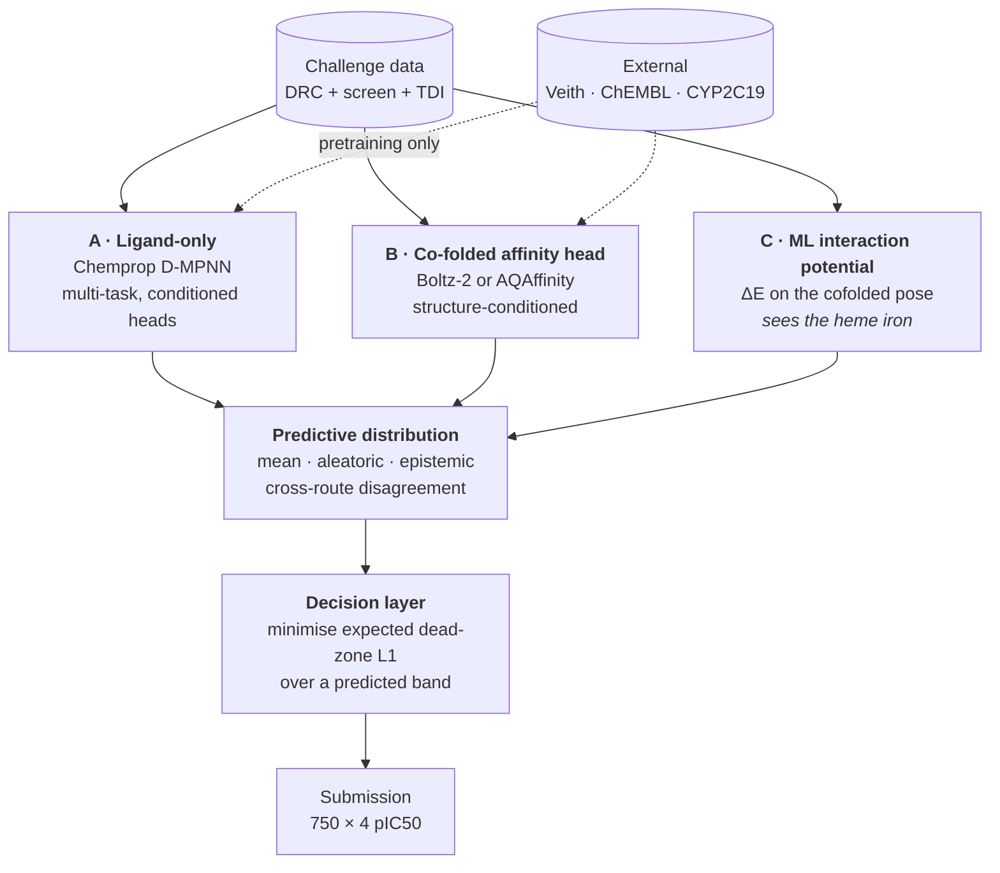

# OpenADMET CYP Inhibition Blind Challenge

Predicting inhibition of the four major drug-metabolising cytochrome P450 isoforms
from small-molecule structure, for the [OpenADMET CYP blind
challenge](https://huggingface.co/spaces/openadmet/cyp-challenge)
(17 Aug – 3 Nov 2026).

The approach combines a ligand-only baseline, a structure-conditioned affinity
model, and a decision layer that optimises predictions against the challenge's
actual loss function rather than against squared error.

---

## The task

| | |
|---|---|
| **Targets** | CYP1A2, CYP2C9, CYP2D6, CYP3A4 |
| **Regression track** | pIC50 for all four isoforms, 750 blinded compounds |
| **Classification track** | time-dependent inhibition boolean, CYP2D6 and CYP3A4 only |
| **Structure track** | pose prediction, 184 complexes, opens mid-challenge |
| **Assay** | fluorogenic probe (1A2/2C9/3A4), mass-spec substrate depletion (2D6) |
| **Interim deadline** | 24 September 2026, 23:59 UTC |
| **Final deadline** | 3 November 2026, 23:59 UTC |
| **Submission limit** | one per 12 hours, latest counts |

### The scoring metric is not squared error

The regression track ranks on **macro-averaged soft-threshold relative absolute
error**. Per isoform:

```
soft_err(p) = max(0, p − conf_high) + max(0, conf_low − p)
ST-RAE      = Σ soft_err(prediction) / Σ soft_err(mean(y_true))
```

Three properties drive every design decision here:

- The error is **zero anywhere inside the 95% credible interval** of the fitted
  dose-response curve. Predictions in the band are free.
- The denominator is the same quantity for the constant mean predictor, so it does
  not depend on the submission. **The objective is a plain sum of dead-zone L1
  errors.**
- Band width is roughly 0.25–0.5 log units for active compounds and **1.2–2.6 below
  pIC50 4**. Inactives are nearly free; actives carry the entire score.

Lower is better, and 1.0 means no better than predicting the mean.

---

## Architecture

Three routes behind one interface. Every route emits the same object — a
**predictive distribution over pIC50 per compound per isoform** — so the decision
layer, the scoring harness and the submission writer are shared and the routes are
swappable and combinable.



**Why these three and not others.** Route A is the floor and the control. Route B
is structure-conditioned but has a known blindness: its affinity head masks
non-polymer tokens out of the pair representation, so the heme cofactor is invisible
to it and type-II iron coordination cannot be scored. Route C closes exactly that
gap, because an interaction-energy potential computes over the real atoms including
the iron. That is orthogonality with a mechanism behind it, which matters more than
individual accuracy when combining models.

**The decision layer is the differentiating piece.** Because the loss has a dead
zone, the point that minimises expected error is not the posterior mean. Under a
bimodal active/inactive posterior a conditional mean lands in the empty middle and
takes error from both sides. Emitting a distribution and choosing the point that
minimises expected dead-zone L1, given a band width predicted from the level, is a
one-dimensional optimisation per compound and is the right answer to the metric.

---

## Data

| source | scale | role |
|---|---|---|
| Dose-response pIC50 | 4,905 compounds, 6,325 labels | primary supervised target |
| **Single-concentration screen** | **4,376 × 4 = 17,504** | **censored bounds, bias correction** |
| Time-dependent inhibition arm | 6,145 compounds | classification track, shift modelling |
| Emax | 6,145 compounds | *inert, not used* |
| Blinded test | 750 compounds | 75 analog series, densely assayed |

**The screening file is the highest-value asset and the least used.** Dose-response
coverage is sparse and non-random — 26% to 48% per isoform — because compounds were
promoted to full curves only if they hit that isoform in the primary screen. The
single-concentration matrix is dense, unbiased, and its fold-change correlates with
pIC50 at Spearman 0.83 to 0.94. It supplies exactly the inactives the supervised
labels lack.

External sources enter as **pretraining or as post-hoc gates, never mixed into the
supervised training set**. CYP2C19 is the best auxiliary target: 14,492 measured
compounds, more than CYP2C9 itself, roughly 91% identical, same pocket.

---

## Repository layout

```
src/cypchallenge/     library code
  data/               loaders, manifests, curation, splits
  features/           fingerprints, descriptors, mechanistic features
  models/             the three routes behind a common interface
  decision/           band model and expected-loss minimisation
  eval/               ST-RAE harness, uncertainty, error analysis
scripts/              CLI entry points
configs/              versioned defaults, overridden by flags
notebooks/            presentation only, no logic
tests/                pytest suite, run in CI
data/                 inputs, gitignored
```

---

## Setup

```bash
mamba env create -f environment.yml && mamba activate cyp
pip install -e ".[dev]"
```

Gated HuggingFace assets need an authenticated account with access granted:

```bash
hf auth login          # or export HF_TOKEN=...
hf auth whoami         # verify
```

---

## The isoforms are not equally hard

Measured on the challenge training data, five-fold cross-validated R², random split:

| isoform | n | physicochemistry | ECFP4 | both | + basic-N features |
|---|---|---|---|---|---|
| CYP3A4 | 2335 | 0.375 | 0.289 | 0.494 | 0.494 |
| CYP2C9 | 1285 | 0.261 | 0.103 | 0.311 | 0.320 |
| CYP1A2 | 1412 | 0.138 | 0.131 | 0.210 | 0.212 |
| **CYP2D6** | 1493 | **0.039** | 0.109 | 0.136 | **0.150** |

**CYP2D6 is a different problem from the other three**, and this is mechanistic
rather than incidental. Its pIC50 correlates with lipophilicity at 0.03, against
0.60 for CYP3A4, and with molecular weight and aromatic ring count at essentially
zero. Bulk physicochemistry reaches negative cross-validated R² on it. What it does
track is a protonated aliphatic amine, worth **+0.55 log units on 2D6 and negative
on all three other isoforms** — the Asp301 and Glu216 ion pair described in the
CYP2D6 crystal structures.

Consequences for the design. The four isoforms should not share one trunk
uncritically: 2C9 and 3A4 correlate at Spearman 0.69, while 2D6 correlates with
everything at 0.06 or below and is measured on a different assay technology. And
CYP2D6 needs a representation that sees a specific substructural interaction, not
a property profile.

---

## Roadmap

### Now — blocking, cheap, before anything else

| # | task | why it blocks |
|---|---|---|
| 1 | Verify whether AQAffinity replicates the Boltz-2 heme mask | decides whether routes B and C are redundant |
| 2 | Reproduce the official ST-RAE end to end on a local holdout | every number downstream is measured through it |
| 3 | Build and freeze a similarity-matched holdout | random-split CV is biased against the feature class that matters most |

### Next — the shared spine

| # | task | notes |
|---|---|---|
| 4 | Package skeleton, manifests, Ruff, tests, CI | provenance recorded from the first download |
| 5 | Define the route interface | predictive distribution in, nothing else |
| 6 | Route A baseline: D-MPNN multi-task, plus a fingerprint control | establishes the floor and the submission plumbing |
| 7 | Auxiliary heads, measured one at a time | screen as censored bounds → Veith → ChEMBL, deduplicated |
| 8 | Swap squared error for the dead-zone loss | needs a custom loss and a channel for the interval bounds |
| 9 | **Build the decision layer** | the piece worth being right about |

### Then — structure, if step 1 clears it

| # | task | notes |
|---|---|---|
| 10 | Route B on the four isoforms | include the heme, constrain the axial bond, template on crystal structures |
| 11 | Route C: interaction-energy potential on the cofolded poses | closes the type-II blindness |
| 12 | Cross-route disagreement as epistemic uncertainty | feeds the decision layer, and is a lower bar than beating a fingerprint on accuracy |
| 13 | CYP2D6 as a dedicated project | it decides the macro average |

### Open directions, not yet committed

- **Pocket-shape target selection.** CYP1B1 and CYP1A1 share CYP1A2's narrow planar
  slot and are the cleanest available test of the criterion. CYP1A2 also has the
  widest local-transfer headroom of the four isoforms.
- **Binding-motif target selection**, kept as a separate arm so we learn which
  criterion pays: aromatase, CYP11B1, CYP11B2 and thromboxane-A synthase total
  11,700 compounds saturated with azoles that coordinate heme iron.
- **Adversarial pose sampling.** The affinity head scores only the single
  highest-confidence pose, in pockets known for multiple simultaneous occupancy.
  Sampling several and taking the distribution is closer to the physics and gives a
  second uncertainty estimate.
- **The structure track**, which is co-folding rather than docking, scored on
  LDDT-PLI, and a separate project with a separate toolchain. Decide after the
  interim leaderboard.
- **Time-dependent inhibition**, where the label is a deterministic function of two
  continuous quantities we already model, so regressing the shift and tuning the
  threshold should beat direct binary classification.

### Approaches evaluated and set aside

| approach | why it was set aside |
|---|---|
| Physics docking scores as features | no published benchmark supports it; multi-ligand occupancy and induced fit make it incoherent |
| Conformer-derived 3D shape descriptors | worse than the mean alone; add 0.01 to 0.05 R² at best |
| Cross-target external data as a fix for CYP2D6 | transfer runs through lipophilicity, the one axis 2D6 does not use |
| Emax file | 5th–95th percentile spans 0.16 log units; no discriminative content |
| Tox21 CYP assays | cell-based reporter and induction assays, different biology |

---

## Method notes

**Validation is the hardest unsolved problem here, not an implementation detail.**
The test set is 75 analog series expanded from training hits, but the training
library is a diversity set containing almost no analog series, so a like-for-like
split cannot be built from it. Random-split cross-validation is not merely biased,
it is *differentially* biased against fingerprints and in favour of descriptors,
which is the reverse of the test-set regime.

**Interim feedback is not an estimate of the final score.** The test set is split
by chemical series, so the half scored during the challenge and the half held back
contain different series. In the preceding OpenADMET PXR challenge, the
[second-placed team](https://github.com/AIDD-LiLab/OpenADMET-PXR-Blind-Challenge-Solutions)
reported their error rising from 0.4777 on the half unblinded mid-challenge to
0.5676 on the half held back, a 19% degradation, with median Tanimoto similarity
between the two halves around 0.26. That is the argument for deriving the decision
rule from the loss function rather than fitting it to interim feedback.

---

## Licence and attribution

Code released open source. Challenge data belongs to OpenADMET and is redistributed
under its own terms. External datasets retain their licences: SAIR is CC-BY-4.0,
AQAffinity is Apache 2.0, Boltz-2 is MIT.
