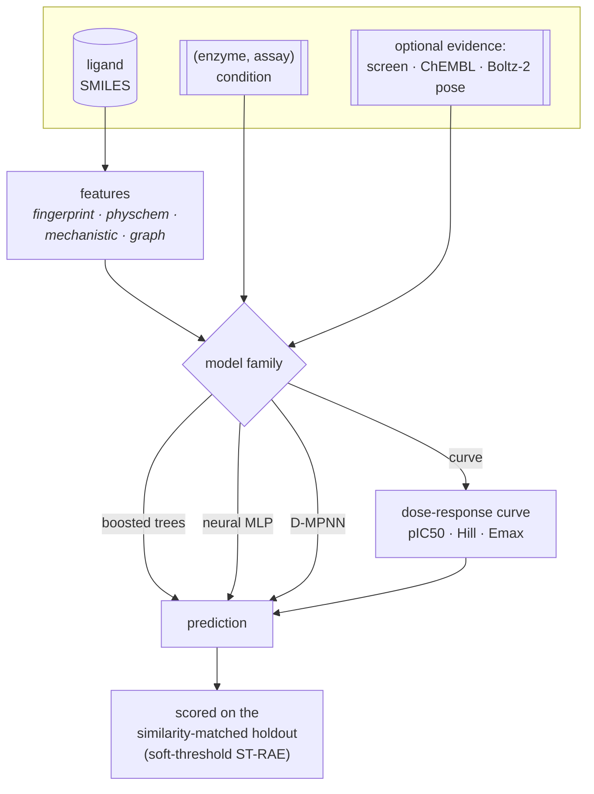

# CYP-Shift

Predicting cytochrome P450 inhibition under an interval-censored loss.
Entry for the [OpenADMET CYP Inhibition Blind Challenge](https://huggingface.co/spaces/openadmet/cyp-challenge),
17 August to 3 November 2026.

> **Why the name.** *Cytochrome P450* is named for a 30 nm shift — its reduced,
> CO-bound form absorbs at 450 nm rather than the usual 420, because an axial
> cysteine thiolate holds the heme iron. The second challenge track asks whether a
> compound's IC50 *shifts* more than two-fold after preincubation. One word, two
> load-bearing meanings.

---

## 📋 At a glance

| | |
|---|---|
| 🎯 **Targets** | CYP1A2 · CYP2C9 · CYP2D6 · CYP3A4 |
| 📈 **Regression track** | pIC50 × 4 isoforms, 750 blinded compounds |
| 🔀 **Classification track** | time-dependent inhibition, CYP2D6 + CYP3A4 only |
| 🧊 **Structure track** | pose prediction, 184 complexes, opens mid-challenge |
| 🔬 **Assay** | fluorogenic probe (1A2/2C9/3A4) · mass-spec depletion (2D6) |
| 📏 **Ranked on** | macro-averaged soft-threshold relative absolute error |
| 🔁 **Submission limit** | 1 per 12 h, latest counts |
| 📦 **Training data** | 4,905 dose-response · 17,504 single-concentration · 6,145 TDI |

### Timeline

| | date | event |
|---|---|---|
| ✅ | 17 Aug 2026 | training and blinded test released, submissions open |
| ⬜ | **24 Sep 2026** | **interim deadline** — buys the one unbiased full-test read |
| ⬜ | 25 Sep 2026 | interim leaderboard; structure track opens |
| ⬜ | **3 Nov 2026** | **final deadline**, 23:59 UTC |
| ⬜ | 4 Nov 2026 | final leaderboard and wrap-up |

---

## 📏 The metric is not squared error

The regression track ranks on a **dead-zone L1 loss**. Per isoform:

```
soft_err(p) = max(0, p − conf_high) + max(0, conf_low − p)
ST-RAE      = Σ soft_err(prediction) / Σ soft_err(mean(y_true))
```

Error is **exactly zero anywhere inside the 95% credible interval** of the fitted
dose-response curve:

```
  error
    ▲
    │╲                                          ╱
    │ ╲                                        ╱
    │  ╲                                      ╱
    │   ╲                                    ╱
    │    ╲__________________________________╱
    │            ← zero error in here →
    └─────┬──────────────────────────────┬──────────►  prediction
       conf_low                     conf_high
```

Three properties drive every design decision in this repository:

| property | consequence |
|---|---|
| Zero error inside the credible band | the optimal point is **not** the posterior mean |
| Denominator is submission-independent | the objective is a **plain sum of dead-zone L1 errors** |
| Band width varies ~10× with activity | inactives are nearly free, actives carry the score |

**Band width, measured on the training set:**

| activity regime | median band width | share of the score |
|---|---|---|
| pIC50 ≥ 4, active | 0.27 – 0.53 log units | almost all of it |
| pIC50 < 4, inactive | 1.21 – 2.59 log units | almost none |

Lower is better. **1.0 means no better than predicting the mean.**

---

## 🏗️ Architecture

The pipeline is **modular**: several model families sit over one shared conditioning
vocabulary and a set of optional evidence sources. A config picks one combination; the
W&B sweeps explore them. Nothing below is hard-wired — each box is a swept choice.



**Two tracks, two environments.** The ligand models run in the `cypshift` environment;
the Boltz-2 cofolding head needs a GPU and its own CUDA stack, so it lives in
`cypshift-struct` (a superset — see [Setup](#️-setup)). Structure features are a GPU
*precompute* cached to disk, so a sweep trial reads them without ever invoking Boltz.

### The curve model

One family, `curve`, predicts a **dose-response curve** and reads every answer off it
the way a biologist reads one off a plot.

```
inhibition(c) = Emax / (1 + 10^(h·(pC − pIC50)))          pC = −log₁₀ c
```

Three parameters per compound, per enzyme, per arm — which makes the three data sources
stop being three tasks:

| source | what it observes | how it enters |
|---|---|---|
| 12-point dose-response | the curve's midpoint | constrains `pIC50` |
| single-concentration screen | **one point on the same curve** | constrains `inhibition(49.5 µM)` |

The curve also carries an `Emax` (plateau) and `Hill` slope, but we do **not** currently
feed Emax measurements as observations — they sit at a pharmacological default prior and
are shaped only indirectly by the fitted rows. The screen is not a pseudo-label and needs
no calibration — it is the curve evaluated
where the experiment sampled it. Preincubation is a **second curve**, not an offset on
the first: it measures enzyme destroyed by turnover, not enzyme occupied, and time
dependence is whatever the two curves say through the organisers' own rule.

### Conditioning — one vocabulary, gated per model

How a model is told *which enzyme and assay* a row came from. Six strategies, and which
a family can use is gated by `supported_conditioning`, because not every one suits every
model:

| strategy | what it does | boosted | neural | graph | curve |
|---|---|:--:|:--:|:--:|:--:|
| `factorised` | target one-hot ⊕ **assay one-hot** (assay identity) | ✅ | ✅ | ✅ | — |
| `metadata` | target one-hot ⊕ **assay property scalars** (preincubation, dose-response) | ✅ | ✅ | ✅ | — |
| `embedding` | a learned `(enzyme, assay)` table | — | ✅ | ~ | — |
| `descriptor` | append the **pocket descriptor** vector | — | ✅ | — | ✅ |
| `heads` | one output **head per condition** | ⇢* | ✅ | — | ✅ |
| `film` | the descriptor **scales/shifts the trunk** | — | ✅ | — | ✅ |

`factorised` and `metadata` are genuinely different, not one inside the other:
factorised gives the assay its own identity column, metadata describes it by its
properties (so it could place an assay it has not seen). A tree has no trunk to embed
into or modulate; the graph model already projects its one-hot through a linear readout;
per-enzyme `heads` for a tree is the separate per-target model (⇢*). The curve model
conditions on its own structure — `heads`/`descriptor`/`film` over its curve parameters.

**The condition routes the loss, not just the forward pass.** A measurement on one
enzyme in one arm produces gradient in exactly that condition and nowhere else — there
is a test asserting it. CYP2C9 and CYP2D6 recognise opposite charges, so leakage
between them would be actively harmful.

### Evidence beyond the ligand

Every source is an independent **use: yes/no** switch (`sources.*`); *how* each one is
folded in is a separate strategy axis (`screen_strategy`, `auxiliary.weighting`, …).
Turning several on composes. The table below is the whole menu.

**🟢 Always on** — the target itself:

| source | data points | what it is |
|---|--:|---|
| challenge dose-response | **6,325** labels · 4,905 compounds | the 12-point curves we are scored on — direct pIC50 per compound × enzyme |

**🎯 Challenge evidence** — more of the *same* experiment, in other shapes:

| `sources.*` | data points | consumed as | note |
|---|--:|---|---|
| `screen` | **17,504** | curve model → a native point at 49.5 µM · scalar models → pseudo-label or surrogate feature | on by default |
| `tdi_arm` | **6,145** | curve → a *second* curve · scalar → a second-assay value | unlocks the classification track |

**🧪 Auxiliary potencies** — outside compounds, deduplicated against the whole challenge.
These are the *where the data comes from* switches; all enter as extra pIC50 rows:

| `sources.*` | data points | note | contamination |
|---|--:|---|---|
| `chembl` | ~1,600 / enzyme | ChEMBL IC50 / Ki | ChEMBL-derived |
| `sair` | ~10.5k / 4 CYPs | real IC50s (poses unused here) | 4 / 750 test → deduped |
| `octant` | ~1,018 (CYP3A4) | **credible intervals kept** | 1 / 750 test → deduped |
| `veith` | ~1.3–4.1k / isoform | qHTS AC50 (luminescent ranking signal) | same 2009 campaign as ChEMBL's AC50 block |

…and **one knob picks which enzymes' rows** to admit from the sources above, on a single
binding-site **distance axis** (`auxiliary.max_distance`). Two moves live on that axis:
pulling a **scored enzyme's own rows** from an outside source (distance 0 — the same
target, a different assay) and pulling a **relative's** rows (distance > 0 — a different
but similar pocket). They are the same operation at different distances, so one knob
covers both: a scored enzyme sits at distance 0 from itself, a relative further out.

| `max_distance` | admits | weighting |
|:--:|---|---|
| `0.0` | the **four scored enzymes' own** rows only (real CYP1A2·2C9·2D6·3A4 straight onto the graded endpoints) | flat `auxiliary.scored_weight` |
| `1.5` *(default)* | the above **+ ~7 near relatives** (non-scored CYPs) | + distance decay (`weighting` · `scale`) |
| `3.0` | the above **+ ~17 relatives**, out to half the unrelated-site distance | + distance decay |

The scored enzymes' own rows are the **CYP2D6 lever**: SAIR/ChEMBL/Veith hold independent
CYP2D6 measurements, and that is the one scored enzyme with no near relative. To use no
auxiliary enzymes at all, leave the source datasets off.

**🧊 Structure** — the cofold, as features:

| `sources.*` | data points | consumed as | contamination |
|---|--:|---|---|
| `structure` | per (compound, enzyme) | Boltz-2 affinity **+** heme-coordination pose, from the cofold cache | poses predicted |

`chembl`, `sair`, `octant` and `veith` compose (shared compounds are median-pooled).
**No auxiliary source is on by default** — with every dataset off, the distance knob has
nothing to pull, so a plain run trains on the challenge data alone. Two honest gaps: **Emax is a curve parameter but is never fed
as an observation**, and **CYP2D6 has no independent public data lever** beyond the
`scored` SAIR/ChEMBL rows.

The structure source is the two heads of the cofold: **(A)** Boltz-2's predicted
affinity for the complex, and **(B)** the pose — how close the inhibitor's coordinating
nitrogen sits to the heme iron. On a validation cofold, imidazole's nitrogen landed
**2.19 Å** from the iron: textbook type-II coordination, and exactly the mechanism the
fingerprint model is measurably worst on.

### Training in stages, not one pooled heap

Pooling every source into one weighted table and fitting once lets a noisy Veith
luminescence row and a clean challenge dose-response label differ only by a scalar. The
alternative is a **curriculum**: learn general structure→potency on the distant, noisier
data first, then adapt to the challenge's own measurements.

The stages are **model-agnostic and defined by the data**. Every observation is stamped
with a `tier`, ordered from farthest to the scored endpoint to the endpoint itself:

| tier | rows |
|---|---|
| `distant_aux` | relatives (distance > 0); the noisier outside datasets |
| `near_aux` | the scored enzymes' own outside rows (distance 0); SAIR |
| `challenge_indirect` | the challenge's single-concentration screen + TDI arm |
| `challenge_direct` | the challenge dose-response — the scored endpoint |

`training.stages` is an ordered list, each stage naming the tiers it trains on and its
**swappable strategy** — `epochs`, `lr`, and `freeze_trunk`. The stages (which data, in
what order) are set deliberately; what varies between runs is a stage's strategy. The
default is a single stage over every tier — the pooled baseline.

```jsonc
"training": { "stages": [
  { "tiers": ["distant_aux", "near_aux"] },                          // pretrain
  { "tiers": ["challenge_indirect", "challenge_direct"],
    "epochs": 30, "lr": 0.0003, "freeze_trunk": true }               // fine-tune, head only
]}
```

**The stage sequence is shared; the transition mechanism is per model.** A neural or curve
model carries its weights forward and, with `freeze_trunk`, holds the shared trunk fixed
so only the conditioning heads adapt (a headless conditioning like `factorised` has
nothing to freeze, so that stage is skipped). The boosted tree has no trunk, so a later
stage **continues boosting** from the previous stage's trees (`init_model`). A stage whose
tier is absent this run is skipped, and a run never trains on nothing. See
[configs/curriculum_example.json](configs/curriculum_example.json).

### Describing an enzyme instead of indexing it

| enzyme | pocket | recognises | volume ų |
|---|---|---|---|
| CYP1A2 | narrow planar slot | flat rigid aromatics | 375 |
| CYP2C9 | **Arg108** | anions — acids | 470 |
| CYP2D6 | **Asp301, Glu216** | cations — basic amines | 540 |
| CYP3A4 | expands >80% on binding | size and greasiness, promiscuously | 1386 |

A one-hot says these are four different symbols. A descriptor says two of them
recognise *opposite* charges, which is why an acid helps at CYP2C9 and hurts at CYP2D6.
That is what transfers: CYP2C9 and CYP2C19 are ~91% identical, so their descriptors
nearly coincide and 14,492 auxiliary compounds pool into a scored endpoint. Adding an
enzyme is a `register()` call, not an architecture change.

Descriptors come from six sources, all recorded and selectable (swept via
`conditioning.descriptor_sources`).

| source | dims | what it encodes |
|---|---|---|
| `cypshift.data.enzymes` | 9 | curated table, crystallographic paper cited per entry |
| `cypshift.data.pocket` | 8 | residue counts and fractions, computed from a PDB entry |
| `cypshift.data.zscales` | 6 | Z-scales of those residues — chemistry, not class counts |
| `cypshift.data.srs` | 21 | the same Z-scales, **per recognition site** |
| `cypshift.data.site` | 21 | the same, from sequence alone — covers all nine enzymes |
| `cypshift.data.ctd` | 42 | the published CYP PCM descriptors, from sequence alone |

The pocket is defined by **what a bound ligand touches**, not by distance from the
heme. That distinction was measured: a 10 Å shell around the iron averages the one
anchoring residue away among ~38 others and gets the charges backwards.

Counting residues by class discards which residue it was — Asp and Glu become the same
symbol. **Z-scales** keep it, mapping each amino acid to three numbers from a principal
component analysis of 26 measured properties (Sandberg 1998). Three dimensions is not
an arbitrary truncation: van Westen benchmarked thirteen protein-descriptor sets for
proteochemometrics and Z-scales(3) with a per-target average won, while the
higher-dimensional sets came out worst.

Conserved P450 motifs are deliberately **not** encoded. FxxGxxxCxG on the heme loop,
ExxR in helix K and the I-helix oxygen-activation motif are invariant across the
superfamily — which is what makes them good for recognising a P450 and useless for
telling two apart. The variable regions are the substrate recognition sites (Gotoh
1992), and the ligand-contact residues are largely drawn from them.

Pooling every contact into one mean has a measured failure, though. The residue that
decides recognition is one or two out of sixteen to twenty-six, so averaging buries it —
CYP2D6's Asp/Glu pair barely moves the mean.

**Encoding each recognition site separately is the fix.** Gotoh showed in 1992 that
specificity concentrates in six hypervariable segments rather than spreading along the
chain. His boundaries are given in a CYP2-family frame anchored on bacterial P450cam,
so they do not transfer by residue number; `cypshift.data.srs` finds the segments from
the structures instead. Contact residues cluster into contiguous runs, and those runs
land at reproducible distances from the heme loop, which `cypshift.data.motifs` locates
in any P450 sequence.

| offset upstream | CYP1A2 | CYP2C9 | CYP2D6 | CYP3A4 | region |
|---|---|---|---|---|---|
| 316–334 | IT · STF | **R108** · VF | LF · FL | **RR**F · SI | SRS1, B′–C loop |
| 211–228 | TFV | LNIL | AGL**E216** | LLFF · T | SRS2, helix F |
| 191–195 | F · F | VM | QFL | F | SRS3, helix G |
| 126–139 | NDGADT | VDGA · T | IA**D301** | IIFA · T | SRS4, helix I |
| 62–69 | L · I | L · L | V · V | IARLE | SRS5, β1-4 |
| ≈ −46 | LT | — | F | G | SRS6, β4 |

Each of the three residues that define recognition falls in a different band, which is
the whole argument for separating them. All contacts are assigned in all four enzymes,
and separation rises **5.1× per dimension** over the pooled version (1.803 against
0.351 RMS), a comparison that already controls for the added width.

CYP3A4 also contacts residues 53–76, upstream of every band the others use. Not an
artefact — Zawaira's expanded map adds SRS1a and SRS1b ahead of Gotoh's SRS1 for
exactly this reason, and it fits CYP3A4's much larger cavity.

**A structure is needed to find the bands, not to use them.** A band is an offset from
the heme loop, and that loop is locatable in any P450 sequence — so once the offsets
are known the binding site can be read straight off a sequence. That is what lets an
auxiliary enzyme with no co-crystal still be described, which is the whole point of
describing an enzyme rather than indexing it. The bands are the observed contact spans
widened by four residues, covering **30% of the chain** against Zawaira's published
33% — four structures measured independently landing on the published figure.

### Comparing enzymes over the binding site

Whole-chain identity is the wrong criterion for choosing what to pretrain on. Two P450s
share an invariant scaffold that inflates any global similarity without saying whether
they prefer the same ligands. `cypshift.data.site` compares only the recognition sites,
and takes an arbitrary pattern, so a hypothesis can be checked directly rather than
against a fixed list of signatures.

Bands are fixed offsets, so sites are the same length and align by construction — but
not quite. A single indel between the anchor and a band slides that band by one, and a
strict comparison then calls two homologous regions unrelated. Measured on CYP1A2
against CYP1A1: SRS4 is `VNLVNDIFGAGFDTVTTAISWS` against `IINIVLDLFGAGFDTVTTAISW`,
plainly homologous and off by one, scored at **0.05**. Sliding each band to its best
offset recovers it to **0.81**, and changes nothing for CYP2C9 against CYP2C19, which
needs no shift anywhere.

| target | closest | next | reads as |
|---|---|---|---|
| CYP1A2 | **CYP1A1** 0.87 | CYP1B1 2.36 | family 1 recovered |
| CYP2C9 | **CYP2C19** 0.53 | CYP2C8 1.28 | subfamily 2C recovered |
| CYP2D6 | CYP2B6 3.16 | CYP2C8 3.18 | no close relative — correct |
| CYP3A4 | CYP2C8 3.96 | CYP2B6 4.01 | no close relative — correct |

The shifts a pair needs are themselves diagnostic: consistent shifts mean one indel,
scattered ones mean the bands are not lining up and the summary number is not safe.

### Reusing the published model's descriptors

`cypshift.data.ctd` reimplements what Lapins and Spjuth conditioned on: Dubchak
composition and transition features over seven amino-acid properties, 42 values from
the primary sequence. Reimplemented rather than called out to, since they used the
PROFEAT web server and a descriptor that cannot be recomputed offline cannot be swept.

It recovers the family structure from sequence alone — every scored enzyme's nearest
neighbour is a relative, CYP2C9 to CYP2C19 at 0.060, the closest pair in the set and
the two that are ~91% identical. But 42 dimensions across 8 enzymes is five times more
numbers than things to tell apart, so it is a comparison, not a default.

### Finding more enzymes to pretrain on

The conserved motifs — FxxGxxxCxG, ExxR, the I-helix pair — are useless for
conditioning, being identical across all eight. That invariance makes them right for
the opposite question: whether an unfamiliar sequence is a P450 close enough to
pretrain on. `scripts/find_related_enzymes.py` scans a FASTA and ranks candidates.

It anchors on the heme loop and scores everything else by distance from it, because
fold order does not work — `ExxR` matches up to six times per sequence and the earliest
is near the N-terminus by chance. Measured: **accepts 9/9** reviewed CYPs, **rejects
8/8** non-P450 controls including catalase, myoglobin, haemoglobin and
myeloperoxidase (the hard cases, since they also bind heme), and accepts **1 of 1800**
sequences shuffled from real CYP composition.

### Proving a descriptor does anything

With eight enzymes the model ever sees eight distinct conditioning vectors, so a
descriptor wide enough to identify each one is a one-hot index wearing a costume —
and no validation curve can tell the difference, because both fit.

`cypshift.eval.transfer` is the test that can. Hold one enzyme out of training
entirely: a one-hot has never seen that index and must fall back to the population
mean, while a descriptor can do better *if and only if* it encodes something
transferable. The gap between them is the effect. Without it, adding a pocket vector
is unfalsifiable, which is why the descriptor set is kept narrow until it earns width.

---

## 🧪 Data

| source | scale | role |
|---|---|---|
| Dose-response pIC50 | 4,905 compounds · 6,325 labels | primary supervised target |
| **Single-concentration screen** | **4,376 × 4 = 17,504** | **censored bounds, bias correction** |
| Time-dependent inhibition arm | 6,145 compounds | classification track |
| Emax | 6,145 compounds | — |
| Blinded test | 750 compounds | 75 analog series |

### Why the screening file matters most

Dose-response coverage is **sparse and non-random**, because compounds were promoted
to full curves only if they hit that isoform in the primary screen:

| isoform | DRC coverage |
|---|---|
| CYP3A4 | 47.6% |
| CYP2D6 | 30.4% |
| CYP1A2 | 28.8% |
| CYP2C9 | 26.2% |

3,596 of 4,905 compounds carry exactly **one** isoform label. Train naively and you
learn "given this compound is a hit, how big a hit", which is not the question the
test set asks.

The single-concentration matrix is dense, unbiased, and its log fold-change is a
near-perfect rank surrogate for pIC50:

| isoform | Spearman(log2FC, pIC50) |
|---|---|
| CYP3A4 | −0.936 |
| CYP2C9 | −0.896 |
| CYP1A2 | −0.862 |
| CYP2D6 | −0.828 |

It supplies exactly the inactives the supervised labels lack. External sources enter
as **pretraining or post-hoc gates, never mixed into the supervised training set**.
CYP2C19 is the best auxiliary target: 14,492 measured compounds, more than CYP2C9
itself, ~91% identical, same pocket.

---

## 📈 Measured so far

Every number is the official metric on similarity-matched holdouts. Lower ST-RAE is
better; 1.0 is the constant mean predictor. Where a result is averaged over splits the
count is stated, because several differences here are smaller than the spread between
splits.

### Model families, head to head

One split, all trained on the same observations:

| model | macro ST-RAE |
|---|---|
| **boosted trees** | **0.6891** |
| curve model | 0.7629 |
| neural network | 0.8682 |
| simple average of the three | 0.7049 |

Averaging loses to the best single family — it drags a good model toward two worse ones.

### What each change is worth

Boosted trees, three splits, each change measured against the one above it:

| configuration | macro ST-RAE | Δ |
|---|---|---|
| plain, no screen, 2048-bit | 0.7034 | — |
| + pooled screen | 0.6771 | −0.0264 |
| + 4096-bit fingerprints | 0.6661 | −0.0374 |
| + CYP2C19 auxiliary data | 0.6748 | −0.0287 |
| **all three, current default** | **0.6625** | **−0.0410** |

Better on all three splits, and close to additive. Two things behind these numbers are
worth stating separately.

**Training on the metric is worth 0.045** — 0.6711 against 0.7164 for squared error and
0.6908 for absolute. That gain appears only once the screen is pooled; measured without
it the same comparison gave −0.0026 at p = 0.42. The objective's value depends on the
training set, which was not obvious.

**Hyperparameter tuning is close to exhausted.** Of leaves, tree count, learning rate
and fingerprint width, only width helped, by 0.0032 at double the cost. Effort belongs
elsewhere.

### Per endpoint, at the current default

| endpoint | ST-RAE |
|---|---|
| CYP3A4 | **0.409** |
| CYP2C9 | 0.693 |
| CYP1A2 | 0.767 |
| CYP2D6 | 0.805 |
| **macro** | **0.669** |

CYP3A4 remains far easier than the rest; CYP2D6 remains the hardest, and has no
auxiliary enzyme within reach to help it.

### Measured so far, with one caveat

These are single-configuration measurements, not verdicts. Everything here is kept and
in scope for tuning; the numbers say where a thing stands today, not that it is finished.

| idea | where it stands | still in the code |
|---|---|---|
| Basic-amine geometry features for CYP2D6 | +0.005 R² on the target endpoint in one CV — marginal so far | yes, in the feature block |
| Screen as a surrogate feature | 0.717 / 0.695 against 0.689 for pooling it as rows — pooling wins for now | yes, a swept option |
| Cross-model disagreement as uncertainty | Spearman +0.088 with error in one reduced test; kept as an epistemic-uncertainty estimate to tune | yes |

Two things were removed rather than kept, both mine and unrequested: a per-compound
**router** between model families (its apparent headroom was a statistical artefact of
taking the minimum error over several models), and the **loss-minimising point
estimate** (it submitted a shifted number instead of the prediction and cost 0.042).


---

## 📊 The isoforms are not equally hard

Five-fold cross-validated R² on the challenge training data, random split:

| isoform | n | physchem | ECFP4 | both | + basic-N |
| CYP3A4 | 2,335 | 0.375 | 0.289 | **0.494** | 0.494 |
| CYP2C9 | 1,285 | 0.261 | 0.103 | **0.311** | 0.320 |
| CYP1A2 | 1,412 | 0.138 | 0.131 | **0.210** | 0.212 |
| **CYP2D6** | 1,493 | **0.039** | 0.109 | **0.136** | **0.150** |

**CYP2D6 is a different problem**, and mechanistically so:

| descriptor | CYP3A4 | CYP2D6 |
|---|---|---|
| Spearman with cLogP | **+0.60** | **+0.03** |
| Spearman with molecular weight | +0.31 | −0.08 |
| Spearman with aromatic rings | +0.34 | −0.01 |
| Δ pIC50 from a basic amine | **−0.36** | **+0.55** |

Bulk physicochemistry reaches **negative** cross-validated R² on CYP2D6. What it
does track is a protonated aliphatic amine, worth +0.55 log units there and negative
on all three other isoforms — the Asp301 and Glu216 ion pair seen in the CYP2D6
crystal structures.

**Design consequences.** The four isoforms should not share one trunk uncritically:
2C9 and 3A4 correlate at Spearman 0.69, while 2D6 correlates with everything at 0.06
or below and is measured on a different assay technology. CYP2D6 needs a
representation that sees a specific substructural interaction, not a property
profile.

---

## 📁 Repository layout

```
src/cypshift/
├── data/          loaders · manifests · curation · splits
├── features/      fingerprints · descriptors · mechanistic features
├── models/        the three models behind a common interface
├── decision/      band model · expected-loss minimisation
└── eval/          ST-RAE harness · uncertainty · error analysis
scripts/           CLI entry points
configs/           versioned defaults, overridden by flags
notebooks/         presentation only, no logic
tests/             pytest suite, run in CI
data/              inputs (gitignored)
```

## ⚙️ Setup

```bash
mamba env create -f environment.yml && mamba activate cypshift
pip install -e ".[dev]"     # everything, including the deep-learning stack
```

`dev` pulls in every runtime extra, so the full test suite runs. To install only what
a given model needs, use the extras directly: the package alone gives the boosted
model, and `.[nn]` adds the neural, graph and curve models.

### Two environments

The ligand and structure tracks have incompatible dependency stacks (a co-folding model
pins its own CUDA-built torch), so they live in separate environments and the pipeline
runs whichever the configured model needs.

```bash
# structure-free: everything the ligand models need
mamba env create -p <prefix>/cypshift -f environment.yml

# structure: the same full stack, then Boltz-2 cofolding on top
mamba env create -p <prefix>/cypshift-struct -f environment.yml
<prefix>/cypshift-struct/bin/pip install boltz
```

The structure environment is a superset of the structure-free one -- built from the same
`environment.yml`, so it runs every ligand model, plus Boltz-2 for the structure track.
Boltz brings its own CUDA-built torch, which chemprop accepts, so the two stacks share
one torch rather than conflicting.

Gated HuggingFace assets need an authenticated account with access granted:

```bash
hf auth login          # or export HF_TOKEN=...
hf auth whoami         # verify
```

---

## 🗺️ Roadmap

### 🚧 Blocking — cheap, and everything else depends on them

| | task | why it blocks |
|---|---|---|
| ✅ | Verify whether AQAffinity replicates the Boltz-2 heme mask | **it does not** — it keeps the ligand-ligand block, so the two are not redundant |
| ✅ | Reproduce the official ST-RAE end to end on a local holdout | every number downstream is measured through it |
| ✅ | Build and freeze a similarity-matched holdout | closes 87% of the gap a random split leaves |

### 🔧 The shared spine

| | task | notes |
|---|---|---|
| ✅ | Package skeleton · manifests · Ruff · tests · CI | provenance recorded from the first download |
| ✅ | **Two environments: structure-free and structure** | `cypshift` (ligand stack) and `cypshift-struct` (Boltz-2 clone + package core), so the two tracks' incompatible deps coexist |
| ✅ | Define the shared model interface | predictive distribution in, nothing else |
| ✅ | Structure-free baseline: fingerprint and descriptor ensemble | **best current MA-ST-RAE 0.6625** (boosted tree, pooled screen, 4096-bit) |
| ✅ | **Use the single-concentration screen** | pooled as pseudo-labels: **+0.0304 macro on 3/3 splits**, now the default |
| ◐ | Chemprop D-MPNN | built on chemprop 2.3.1; **not yet scored** against the tree (measurement in progress) |
| ✅ | Auxiliary data from ChEMBL, deduplicated | CYP2C19: 1,618 compounds, **+0.006 macro on 2/3 splits**; beats shuffled-label control by 0.009 |
| ✅ | Train on the soft-threshold metric | **worth 0.045 over squared error** once the screen is pooled |
| ✅ | **Score the TDI track** | official metrics vendored: MCC, accuracy, precision, recall, F1; ranked by MCC |

### 🧊 Structure work, if the blocking check clears it

| | task | notes |
|---|---|---|
| ✅ | Co-folded affinity + pose head via Boltz-2 | `cypshift.structure`: cofolds CYP+heme+inhibitor, extracts Boltz affinity **and** pose features, cached per pair; **validated end-to-end** (imidazole+CYP1A2, 9.5 min on the laptop GPU) |
| ✅ | Type-II pose feature: coordinating N to heme iron | measured real on the cofold — imidazole's N sits **2.19 Å from the iron**, textbook type-II coordination; wired into the boosted model via `features.use_structure` |
| ◐ | Disagreement between models as epistemic uncertainty | built (`eval/disagreement.py`, cross-model spread + conformal width); an epistemic-uncertainty estimate to tune, not yet wired into a submission |
| ⬜ | CYP2D6 as a dedicated project | it decides the macro average; the basic-amine geometry probe was marginal |

### 🔭 Open directions, not yet committed

| direction | rationale |
|---|---|
| 🧩 **Pocket-shape target selection** | CYP1B1 and CYP1A1 share CYP1A2's narrow planar slot — the cleanest available test of the criterion |
| ⚗️ **Binding-motif target selection** | aromatase, CYP11B1/B2 and thromboxane-A synthase total 11,700 compounds saturated with heme-coordinating azoles |
| 🎲 **Adversarial pose sampling** | the affinity head scores one pose, in pockets known for multiple simultaneous occupancy |
| 🧊 **The structure track** | co-folding rather than docking, scored on LDDT-PLI; decide after the interim leaderboard |


### 🧪 Tried once or reasoned against — open, not closed

None of these is settled. Each was either measured a single time or argued against from
first principles; they remain candidates to revisit, especially under tuning or a
different model.

| approach | current reason for the pause |
|---|---|
| Conformer-derived 3D shape descriptors | one test added little (~0.01–0.05 R²), but never tuned or combined with the current model |
| Physics docking scores as features | no published benchmark found to support it, and multi-ligand occupancy complicates it — not tested here |
| Cross-target external data as a CYP2D6 fix | the plausible transfer axis is lipophilicity, which 2D6 barely uses; not measured directly |
| Emax file | its 5th–95th percentile spans 0.16 log units, so little to predict — worth a second look if a use appears |
| Tox21 CYP assays | cell-based reporter and induction assays, a different biology than the microsomal endpoint |

---

## 📝 Method notes

**Assay conditioning is not degenerate, at least for trees.** Concatenating a one-hot
at a network's input can only shift its output, so a model can satisfy assay
conditioning by learning a per-assay constant and nothing more — a real risk here,
since screen pseudo-labels sit about two log units below curve labels and an intercept
would explain most of that. Measured on the boosted model, predicting the same
compounds under both assays: mean difference 0.264, **spread across compounds 0.268**.
The per-compound variation is as large as the average effect, so the conditioning
carries chemistry rather than an offset.

That result does not transfer to the other models. A tree splits on the assay column
and then on fingerprint bits inside that branch, which is an interaction by
construction; a linear first layer cannot do that. The check therefore has to be
re-run per model, and `cypshift.eval.uncertainty.conditioning_is_additive` exists for
that.


**Validation is the hardest unsolved problem here, not an implementation detail.**
The test set is 75 analog series expanded from training hits, but the training
library is a diversity set containing almost no analog series, so a like-for-like
split cannot be built from it. Random-split cross-validation is not merely biased —
it is *differentially* biased against fingerprints and in favour of descriptors,
which is the reverse of the test-set regime.

**Interim feedback is not an estimate of the final score.** The test set is split by
chemical series, so the half scored during the challenge and the half held back
contain different series. In the preceding OpenADMET PXR challenge, the
[second-placed team](https://github.com/AIDD-LiLab/OpenADMET-PXR-Blind-Challenge-Solutions)
reported their error rising from 0.4777 on the half unblinded mid-challenge to
0.5676 on the half held back — a 19% degradation, with median Tanimoto similarity
between halves around 0.26. That is the argument for deriving the decision rule from
the loss function rather than fitting it to interim feedback.

---

## 📖 Terms

Every term below carries where it comes from, because a glossary the authors write
themselves cannot certify their own vocabulary. Anything marked *plain description*
is not a term of art — it is ordinary words for an ordinary thing, and should be
replaced if the field turns out to have a name for it.

| term | meaning | source |
|---|---|---|
| **pIC50** | −log₁₀ of the concentration giving half-maximal inhibition | field standard |
| **isoform** | one of the four CYP enzymes predicted | field standard |
| **credible interval** | 95% interval on a fitted value, shipped as `_conf_low` / `_conf_high` | challenge: `REGRESSION_CREDIBLE_INTERVALS_*_SUFFIX` |
| **ST-RAE** | the ranked metric: distance to the nearest credible-interval bound, zero inside. Lower is better, 1.0 equals a constant predictor | challenge: `ACTIVITY_METRICS` |
| **soft-threshold** | the qualifier the organisers use for that metric | challenge: "Soft-Threshold Scoring" |
| **arm** | an assay condition — the direct-inhibition arm, the TDI arm | challenge: "direct inhibition and TDI arms" |
| **p-value** | one-sided bootstrap p-value on a paired comparison | challenge: `p_value` column in its head-to-head |
| **point estimate** | the single number submitted | statistics |
| **conformal prediction** | rescaling an interval on held-out data so its coverage is honest | statistics |
| **conditioning** | making a model's output depend on which isoform and assay a row came from | machine learning standard |
| **one-hot encoding** | the current implementation of that conditioning; swappable for an embedding | machine learning standard |
| **proteochemometrics** | modelling ligand and protein jointly, so one model spans several targets | field standard — van Westen, *J Cheminform* 2013;5:41 |
| **Z-scales** | three principal components of 26 measured amino-acid properties | field standard — Sandberg, *J Med Chem* 1998;41:2481 |
| **substrate recognition site** | the hypervariable CYP segments that set substrate specificity | field standard — Gotoh, *J Biol Chem* 1992;267:83 |
| **leave-one-target-out** | holding one enzyme out of training entirely to test whether a descriptor transfers | machine learning standard |
| **structure-free** | uses no 3D structure; the protein still enters as isoform identity | *plain description* |
| **similarity-matched holdout** | a holdout whose nearest-neighbour similarity profile matches the test set's | *plain description* |

---

## 📄 Licence

Code released under MIT. Challenge data belongs to OpenADMET under its own terms.
External datasets retain their licences: SAIR is CC-BY-4.0, AQAffinity Apache 2.0,
Boltz-2 MIT.
