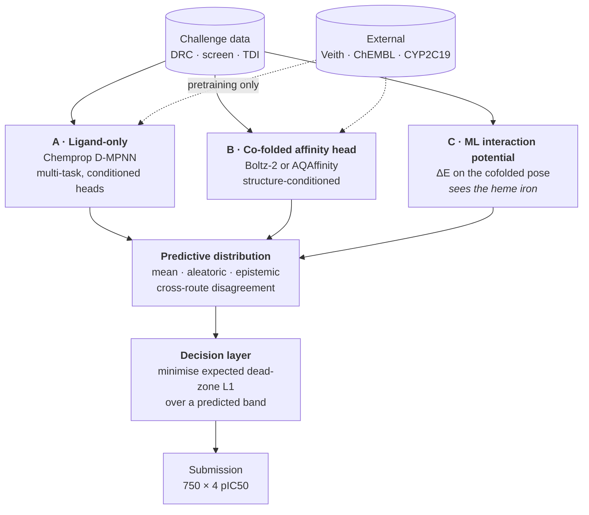

# CYP-Shift

Predicting cytochrome P450 inhibition under an interval-censored loss.
Entry for the [OpenADMET CYP Inhibition Blind Challenge](https://huggingface.co/spaces/openadmet/cyp-challenge),
17 August to 3 November 2026.

> **Why the name.** *Cytochrome P450* is named for a 30 nm shift — its reduced,
> CO-bound form absorbs at 450 nm rather than the usual 420, because an axial
> cysteine thiolate holds the heme iron. The second challenge track asks whether a
> compound's IC50 *shifts* more than two-fold after preincubation. One word, two
> load-bearing meanings.

---

## 📋 At a glance

| | |
|---|---|
| 🎯 **Targets** | CYP1A2 · CYP2C9 · CYP2D6 · CYP3A4 |
| 📈 **Regression track** | pIC50 × 4 isoforms, 750 blinded compounds |
| 🔀 **Classification track** | time-dependent inhibition, CYP2D6 + CYP3A4 only |
| 🧊 **Structure track** | pose prediction, 184 complexes, opens mid-challenge |
| 🔬 **Assay** | fluorogenic probe (1A2/2C9/3A4) · mass-spec depletion (2D6) |
| 📏 **Ranked on** | macro-averaged soft-threshold relative absolute error |
| 🔁 **Submission limit** | 1 per 12 h, latest counts |
| 📦 **Training data** | 4,905 dose-response · 17,504 single-concentration · 6,145 TDI |

### Timeline

| | date | event |
|---|---|---|
| ✅ | 17 Aug 2026 | training and blinded test released, submissions open |
| ⬜ | **24 Sep 2026** | **interim deadline** — buys the one unbiased full-test read |
| ⬜ | 25 Sep 2026 | interim leaderboard; structure track opens |
| ⬜ | **3 Nov 2026** | **final deadline**, 23:59 UTC |
| ⬜ | 4 Nov 2026 | final leaderboard and wrap-up |

---

## 📏 The metric is not squared error

The regression track ranks on a **dead-zone L1 loss**. Per isoform:

```
soft_err(p) = max(0, p − conf_high) + max(0, conf_low − p)
ST-RAE      = Σ soft_err(prediction) / Σ soft_err(mean(y_true))
```

Error is **exactly zero anywhere inside the 95% credible interval** of the fitted
dose-response curve:

```
  error
    ▲
    │╲                                          ╱
    │ ╲                                        ╱
    │  ╲                                      ╱
    │   ╲                                    ╱
    │    ╲__________________________________╱
    │            ← zero error in here →
    └─────┬──────────────────────────────┬──────────►  prediction
       conf_low                     conf_high
```

Three properties drive every design decision in this repository:

| property | consequence |
|---|---|
| Zero error inside the credible band | the optimal point is **not** the posterior mean |
| Denominator is submission-independent | the objective is a **plain sum of dead-zone L1 errors** |
| Band width varies ~10× with activity | inactives are nearly free, actives carry the score |

**Band width, measured on the training set:**

| activity regime | median band width | share of the score |
|---|---|---|
| pIC50 ≥ 4, active | 0.27 – 0.53 log units | almost all of it |
| pIC50 < 4, inactive | 1.21 – 2.59 log units | almost none |

Lower is better. **1.0 means no better than predicting the mean.**

---

## 🏗️ Architecture

Three routes behind one interface. Every route emits the same object — a
**predictive distribution over pIC50 per compound per isoform** — so the decision
layer, the scoring harness and the submission writer are shared, and the routes stay
swappable and combinable.



| route | sees structure? | sees the heme? | role |
|---|---|---|---|
| **A** · Ligand-only | ❌ | ❌ | the floor and the control |
| **B** · Co-folded affinity head | ✅ | ❌ *masked out* | structure-conditioned signal |
| **C** · ML interaction potential | ✅ | ✅ | closes B's blind spot |

**Why route C exists.** The Boltz-2 affinity head builds its pair representation
from protein tokens only, so non-polymer cofactors are masked out before the head
sees them — confirmed in source and stated in the paper's own limitations. The heme
is therefore invisible to it, and type-II inhibitors that coordinate the iron
directly (imidazoles, triazoles, pyridines) cannot be scored on the interaction that
makes them bind. An interaction-energy potential computes over the real atoms,
iron included. That is orthogonality with a mechanism behind it, which matters more
than individual accuracy when combining models.

**Why the decision layer is the differentiating piece.** Because the loss has a dead
zone, the point minimising expected error is not the posterior mean. Under a bimodal
active/inactive posterior, a conditional mean lands in the empty middle and takes
error from both sides. Emitting a distribution and choosing the point that minimises
expected dead-zone L1, given a band width predicted from the level, is a
one-dimensional optimisation per compound and is the correct answer to this metric.

---

## 🧪 Data

| source | scale | role |
|---|---|---|
| Dose-response pIC50 | 4,905 compounds · 6,325 labels | primary supervised target |
| **Single-concentration screen** | **4,376 × 4 = 17,504** | **censored bounds, bias correction** |
| Time-dependent inhibition arm | 6,145 compounds | classification track |
| Emax | 6,145 compounds | — |
| Blinded test | 750 compounds | 75 analog series |

### Why the screening file matters most

Dose-response coverage is **sparse and non-random**, because compounds were promoted
to full curves only if they hit that isoform in the primary screen:

| isoform | DRC coverage |
|---|---|
| CYP3A4 | 47.6% |
| CYP2D6 | 30.4% |
| CYP1A2 | 28.8% |
| CYP2C9 | 26.2% |

3,596 of 4,905 compounds carry exactly **one** isoform label. Train naively and you
learn "given this compound is a hit, how big a hit", which is not the question the
test set asks.

The single-concentration matrix is dense, unbiased, and its log fold-change is a
near-perfect rank surrogate for pIC50:

| isoform | Spearman(log2FC, pIC50) |
|---|---|
| CYP3A4 | −0.936 |
| CYP2C9 | −0.896 |
| CYP1A2 | −0.862 |
| CYP2D6 | −0.828 |

It supplies exactly the inactives the supervised labels lack. External sources enter
as **pretraining or post-hoc gates, never mixed into the supervised training set**.
CYP2C19 is the best auxiliary target: 14,492 measured compounds, more than CYP2C9
itself, ~91% identical, same pocket.

---

## 📈 Measured so far

Ligand-only ensemble, untuned, scored with the official metric on the
similarity-matched holdout (491 compounds). Lower ST-RAE is better; 1.0 is the
constant mean predictor.

| endpoint | ST-RAE | MAE | R² | Spearman ρ |
|---|---|---|---|---|
| CYP3A4 | **0.607** | 0.543 | 0.558 | 0.721 |
| CYP2D6 | 0.806 | 0.614 | 0.224 | 0.556 |
| CYP1A2 | 0.827 | 0.728 | 0.212 | 0.456 |
| CYP2C9 | 0.831 | 0.538 | 0.194 | 0.479 |
| **macro** | **0.768** | 0.606 | 0.297 | 0.553 |

Read this as a floor, not as a leaderboard prediction. The holdout is deliberately
built to resemble the blinded test set, but it cannot reproduce the analog-series
structure that makes the real test set easier, so the same model should score better
there. Note also that the endpoint ordering differs from the public leaderboard,
where CYP2C9 is the *easiest* endpoint and CYP2D6 the hardest. That difference is
itself informative: it says CYP2C9 benefits most from the test set's local analog
structure, which a holdout drawn from a diversity library cannot supply.

---

## 📊 The isoforms are not equally hard

Five-fold cross-validated R² on the challenge training data, random split:

| isoform | n | physchem | ECFP4 | both | + basic-N |
| CYP3A4 | 2,335 | 0.375 | 0.289 | **0.494** | 0.494 |
| CYP2C9 | 1,285 | 0.261 | 0.103 | **0.311** | 0.320 |
| CYP1A2 | 1,412 | 0.138 | 0.131 | **0.210** | 0.212 |
| **CYP2D6** | 1,493 | **0.039** | 0.109 | **0.136** | **0.150** |

**CYP2D6 is a different problem**, and mechanistically so:

| descriptor | CYP3A4 | CYP2D6 |
|---|---|---|
| Spearman with cLogP | **+0.60** | **+0.03** |
| Spearman with molecular weight | +0.31 | −0.08 |
| Spearman with aromatic rings | +0.34 | −0.01 |
| Δ pIC50 from a basic amine | **−0.36** | **+0.55** |

Bulk physicochemistry reaches **negative** cross-validated R² on CYP2D6. What it
does track is a protonated aliphatic amine, worth +0.55 log units there and negative
on all three other isoforms — the Asp301 and Glu216 ion pair seen in the CYP2D6
crystal structures.

**Design consequences.** The four isoforms should not share one trunk uncritically:
2C9 and 3A4 correlate at Spearman 0.69, while 2D6 correlates with everything at 0.06
or below and is measured on a different assay technology. CYP2D6 needs a
representation that sees a specific substructural interaction, not a property
profile.

---

## 📁 Repository layout

```
src/cypshift/
├── data/          loaders · manifests · curation · splits
├── features/      fingerprints · descriptors · mechanistic features
├── models/        the three routes behind a common interface
├── decision/      band model · expected-loss minimisation
└── eval/          ST-RAE harness · uncertainty · error analysis
scripts/           CLI entry points
configs/           versioned defaults, overridden by flags
notebooks/         presentation only, no logic
tests/             pytest suite, run in CI
data/              inputs (gitignored)
```

## ⚙️ Setup

```bash
mamba env create -f environment.yml && mamba activate cypshift
pip install -e ".[dev]"
```

Gated HuggingFace assets need an authenticated account with access granted:

```bash
hf auth login          # or export HF_TOKEN=...
hf auth whoami         # verify
```

---

## 🗺️ Roadmap

### 🚧 Blocking — cheap, and everything else depends on them

| | task | why it blocks |
|---|---|---|
| ⬜ | Verify whether AQAffinity replicates the Boltz-2 heme mask | decides whether routes B and C are redundant |
| ✅ | Reproduce the official ST-RAE end to end on a local holdout | every number downstream is measured through it |
| ✅ | Build and freeze a similarity-matched holdout | closes 87% of the gap a random split leaves |

### 🔧 The shared spine

| | task | notes |
|---|---|---|
| ✅ | Package skeleton · manifests · Ruff · tests · CI | provenance recorded from the first download |
| ✅ | Define the route interface | predictive distribution in, nothing else |
| ✅ | Route A baseline: fingerprint and descriptor ensemble | **MA-ST-RAE 0.768**, see below |
| ⬜ | Route A: swap in a Chemprop D-MPNN | the multi-task and pretraining path |
| ⬜ | Auxiliary heads, measured one at a time | screen as censored bounds → Veith → ChEMBL, deduplicated |
| ⬜ | Swap squared error for the dead-zone loss | needs a custom loss and a channel for the interval bounds |
| ⬜ | **Build the decision layer** | the piece worth being right about |

### 🧊 Structure work, if the blocking check clears it

| | task | notes |
|---|---|---|
| ⬜ | Route B on the four isoforms | include the heme, constrain the axial bond, template on crystal structures |
| ⬜ | Route C: interaction-energy potential on cofolded poses | closes the type-II blindness |
| ⬜ | Cross-route disagreement as epistemic uncertainty | a lower bar than beating a fingerprint on accuracy |
| ⬜ | CYP2D6 as a dedicated project | it decides the macro average |

### 🔭 Open directions, not yet committed

| direction | rationale |
|---|---|
| 🧩 **Pocket-shape target selection** | CYP1B1 and CYP1A1 share CYP1A2's narrow planar slot — the cleanest available test of the criterion |
| ⚗️ **Binding-motif target selection** | aromatase, CYP11B1/B2 and thromboxane-A synthase total 11,700 compounds saturated with heme-coordinating azoles |
| 🎲 **Adversarial pose sampling** | the affinity head scores one pose, in pockets known for multiple simultaneous occupancy |
| 🧊 **The structure track** | co-folding rather than docking, scored on LDDT-PLI; decide after the interim leaderboard |
| ⏱️ **Time-dependent inhibition** | the label is a deterministic function of two continuous quantities we already model |

### ⛔ Approaches evaluated and set aside

| approach | why |
|---|---|
| Physics docking scores as features | no published benchmark supports it; multi-ligand occupancy and induced fit make it incoherent |
| Conformer-derived 3D shape descriptors | worse than the mean alone; add 0.01–0.05 R² at best |
| Cross-target external data as a CYP2D6 fix | transfer runs through lipophilicity, the one axis 2D6 does not use |
| Emax file | 5th–95th percentile spans 0.16 log units; no discriminative content |
| Tox21 CYP assays | cell-based reporter and induction assays, different biology |

---

## 📝 Method notes

**Validation is the hardest unsolved problem here, not an implementation detail.**
The test set is 75 analog series expanded from training hits, but the training
library is a diversity set containing almost no analog series, so a like-for-like
split cannot be built from it. Random-split cross-validation is not merely biased —
it is *differentially* biased against fingerprints and in favour of descriptors,
which is the reverse of the test-set regime.

**Interim feedback is not an estimate of the final score.** The test set is split by
chemical series, so the half scored during the challenge and the half held back
contain different series. In the preceding OpenADMET PXR challenge, the
[second-placed team](https://github.com/AIDD-LiLab/OpenADMET-PXR-Blind-Challenge-Solutions)
reported their error rising from 0.4777 on the half unblinded mid-challenge to
0.5676 on the half held back — a 19% degradation, with median Tanimoto similarity
between halves around 0.26. That is the argument for deriving the decision rule from
the loss function rather than fitting it to interim feedback.

---

## 📄 Licence

Code released under MIT. Challenge data belongs to OpenADMET under its own terms.
External datasets retain their licences: SAIR is CC-BY-4.0, AQAffinity Apache 2.0,
Boltz-2 MIT.
