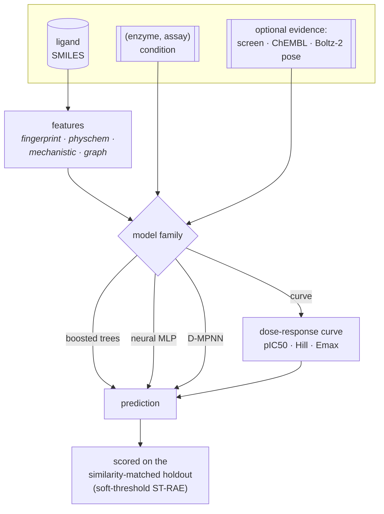

# CYP-Shift

Predicting cytochrome P450 inhibition under an interval-censored loss.
Entry for the [OpenADMET CYP Inhibition Blind Challenge](https://huggingface.co/spaces/openadmet/cyp-challenge),
17 August to 3 November 2026.

> **Why the name.** *Cytochrome P450* is named for a 30 nm shift — its reduced,
> CO-bound form absorbs at 450 nm rather than the usual 420, because an axial
> cysteine thiolate holds the heme iron. The second challenge track asks whether a
> compound's IC50 *shifts* more than two-fold after preincubation. One word, two
> load-bearing meanings.

---

## 📋 At a glance

| | |
|---|---|
| 🎯 **Targets** | CYP1A2 · CYP2C9 · CYP2D6 · CYP3A4 |
| 📈 **Regression track** | pIC50 × 4 isoforms, 750 blinded compounds |
| 🔀 **Classification track** | time-dependent inhibition, CYP2D6 + CYP3A4 only |
| 🧊 **Structure track** | pose prediction, 20 CYP3A4 complexes, opens mid-challenge |
| 🔬 **Assay** | fluorogenic probe (1A2/2C9/3A4) · mass-spec depletion (2D6) |
| 📏 **Ranked on** | macro-averaged soft-threshold relative absolute error |
| 🔁 **Submission limit** | 1 per 12 h, latest counts |
| 📦 **Training data** | 4,905 dose-response · 17,504 single-concentration · 6,145 TDI |

### Timeline

| | date | event |
|---|---|---|
| ✅ | 17 Aug 2026 | training and blinded test released, submissions open |
| ⬜ | **24 Sep 2026** | **interim deadline** — buys the one unbiased full-test read |
| ⬜ | 25 Sep 2026 | interim leaderboard; structure track opens |
| ⬜ | **3 Nov 2026** | **final deadline**, 23:59 UTC |
| ⬜ | 4 Nov 2026 | final leaderboard and wrap-up |

---

## 📏 The soft-threshold metric

The regression track ranks on a **dead-zone L1 loss**. Per isoform:

```
soft_err(p) = max(0, p − conf_high) + max(0, conf_low − p)
ST-RAE      = Σ soft_err(prediction) / Σ soft_err(mean(y_true))
```

Error is **exactly zero anywhere inside the 95% credible interval** of the fitted
dose-response curve:

```
  error
    ▲
    │╲                                          ╱
    │ ╲                                        ╱
    │  ╲                                      ╱
    │   ╲                                    ╱
    │    ╲__________________________________╱
    │            ← zero error in here →
    └─────┬──────────────────────────────┬──────────►  prediction
       conf_low                     conf_high
```

Three properties drive every design decision in this repository:

| property | consequence |
|---|---|
| Zero error inside the credible band | the optimal point is **not** the posterior mean |
| Denominator is submission-independent | the objective is a **plain sum of dead-zone L1 errors** |
| Band width varies ~10× with activity | inactives are nearly free, actives carry the score |

Band width is ~0.3–0.5 log units for actives (pIC50 ≥ 4) against ~1.2–2.6 for inactives,
so the actives carry almost all the score. Lower ST-RAE is better; **1.0 = predicting the mean.**

---

## 🏗️ Architecture

The pipeline is **modular**: several model families sit over one shared conditioning
vocabulary and a set of optional evidence sources. A config picks one combination; the
W&B sweeps explore them. Nothing below is hard-wired — each box is a swept choice.



**Two tracks, two environments.** The ligand models run in the `cypshift` environment;
the Boltz-2 cofolding head needs a GPU and its own CUDA stack, so it lives in
`cypshift-struct` (a superset — see [Setup](#️-setup)). Structure features are a GPU
*precompute* cached to disk, so a sweep trial reads them without ever invoking Boltz.

### The curve model

One family, `curve`, predicts a **dose-response curve** and reads every answer off it
the way a biologist reads one off a plot.

```
inhibition(c) = Emax / (1 + 10^(h·(pC − pIC50)))          pC = −log₁₀ c
```

Three parameters per compound, per enzyme, per arm — which makes the three data sources
stop being three tasks:

| source | what it observes | how it enters |
|---|---|---|
| 12-point dose-response | the curve's midpoint | constrains `pIC50` |
| single-concentration screen | **one point on the same curve** | constrains `inhibition(49.5 µM)` |

The curve also carries an `Emax` (plateau) and `Hill` slope, but we do **not** currently
feed Emax measurements as observations — they sit at a pharmacological default prior and
are shaped only indirectly by the fitted rows. The screen is not a pseudo-label and needs
no calibration — it is the curve evaluated
where the experiment sampled it. Preincubation is a **second curve**, not an offset on
the first: it measures enzyme destroyed by turnover, not enzyme occupied, and time
dependence is whatever the two curves say through the organisers' own rule.

### Conditioning

How a model is told *which enzyme and assay* a row came from. Six strategies, and which
a family can use is gated by `supported_conditioning`, because not every one suits every
model:

| strategy | what it does | boosted | neural | graph | curve |
|---|---|:--:|:--:|:--:|:--:|
| `factorised` | target one-hot ⊕ **assay one-hot** (assay identity) | ✅ | ✅ | ✅ | — |
| `metadata` | target one-hot ⊕ **assay property scalars** (preincubation, dose-response) | ✅ | ✅ | ✅ | — |
| `embedding` | a learned `(enzyme, assay)` table | — | ✅ | ~ | — |
| `descriptor` | append the **pocket descriptor** vector | — | ✅ | — | ✅ |
| `heads` | one output **head per condition** | ⇢* | ✅ | — | ✅ |
| `film` | the descriptor **scales/shifts the trunk** | — | ✅ | — | ✅ |
| `calibration` | shared potency conditioned on the **enzyme**, + a learned **per-assay offset** | — | ✅ | — | — |

`calibration` is the principled fix for pooling different platforms. The trunk predicts
one latent potency `f(molecule, enzyme)` on the reference assay's scale (the challenge
dose-response), and each assay carries a learned bias, recentred so the reference is zero.
A luminescent AC50's systematic offset from a fluorogenic IC50 is absorbed into its bias
and shapes `f` without dragging its scale; predictions are made at the reference, so they
come back on the challenge scale rather than the pooled average. It needs the
detection-chemistry assay split to have distinct assays to offset apart.

`factorised` and `metadata` are genuinely different, not one inside the other:
factorised gives the assay its own identity column, metadata describes it by its
properties (so it could place an assay it has not seen). A tree has no trunk to embed
into or modulate; the graph model already projects its one-hot through a linear readout;
per-enzyme `heads` for a tree is the separate per-target model (⇢*). The curve model
conditions on its own structure — `heads`/`descriptor`/`film` over its curve parameters.

**The condition routes the loss, not just the forward pass.** A measurement on one
enzyme in one arm produces gradient in exactly that condition and nowhere else — there
is a test asserting it. CYP2C9 and CYP2D6 recognise opposite charges, so leakage
between them would be actively harmful.

### Evidence beyond the ligand

Every source is an independent **use: yes/no** switch (`sources.*`); *how* each one is
folded in is a separate strategy axis (`screen_strategy`, `auxiliary.weighting`, …).
Turning several on composes. The table below is the whole menu.

**🟢 Always on** — the target itself:

| source | data points | what it is |
|---|--:|---|
| challenge dose-response | **6,525** labels · 4,905 compounds | the 12-point curves we are scored on — direct pIC50 per compound × enzyme |

**🎯 Challenge evidence** — more of the *same* experiment, in other shapes:

| `sources.*` | data points | consumed as | note |
|---|--:|---|---|
| `screen` | **17,504** | curve model → a native point at 49.5 µM · scalar models → pseudo-label or surrogate feature | on by default |
| `tdi_arm` | **6,145** | curve → a *second* curve · scalar → a second-assay value | unlocks the classification track |

**🧪 Auxiliary potencies** — outside compounds, deduplicated against the whole challenge.
These are the *where the data comes from* switches; all enter as extra pIC50 rows:

| `sources.*` | data points | note | contamination |
|---|--:|---|---|
| `chembl` | ~1,600 / enzyme | ChEMBL IC50 / Ki | ChEMBL-derived |
| `sair` | ~10.5k / 4 CYPs | real IC50s (poses unused here) | 4 / 750 test → deduped |
| `octant` | ~1,018 (CYP3A4) | **credible intervals kept** | 1 / 750 test → deduped |
| `veith` | ~1.3–4.1k / isoform | qHTS AC50 (luminescent ranking signal) | same 2009 campaign as ChEMBL's AC50 block |
| `tox21` | ~1.5–2.8k / isoform | 2025 NCATS P450-Glo IC50 (biochemical, distinct library) | overlaps challenge/ChEMBL → deduped |
| `novartis` | ~16.1k for 3A4·2C9·**2D6** | Polaris reversible pIC50 (also carries a CYP3A4 TDI signal) | ~260 challenge → deduped |

…and **one knob picks which enzymes' rows** to admit from the sources above, on a single
binding-site **distance axis** (`auxiliary.max_distance`). Two moves live on that axis:
pulling a **scored enzyme's own rows** from an outside source (distance 0 — the same
target, a different assay) and pulling a **relative's** rows (distance > 0 — a different
but similar pocket). They are the same operation at different distances, so one knob
covers both: a scored enzyme sits at distance 0 from itself, a relative further out.

| `max_distance` | admits | weighting |
|:--:|---|---|
| `0.0` | the **four scored enzymes' own** rows only (real CYP1A2·2C9·2D6·3A4 straight onto the graded endpoints) | flat `auxiliary.scored_weight` |
| `1.5` *(default)* | the above **+ ~7 near relatives** (non-scored CYPs) | + distance decay (`weighting` · `scale`) |
| `3.0` | the above **+ ~17 relatives**, out to half the unrelated-site distance | + distance decay |

The scored enzymes' own rows are the **CYP2D6 lever**: SAIR/ChEMBL/Veith hold independent
CYP2D6 measurements, and that is the one scored enzyme with no near relative. To use no
auxiliary enzymes at all, leave the source datasets off.

**🧊 Structure** — the cofold, as features:

| `sources.*` | data points | consumed as | contamination |
|---|--:|---|---|
| `structure` | per (compound, enzyme) | Boltz-2 affinity **+** heme-coordination pose, from the cofold cache | poses predicted |

`chembl`, `sair`, `octant` and `veith` compose (shared compounds are median-pooled).
**No auxiliary source is on by default** — with every dataset off, the distance knob has
nothing to pull, so a plain run trains on the challenge data alone. Two honest gaps: **Emax is a curve parameter but is never fed
as an observation**, and **CYP2D6 has no independent public data lever** beyond the
`scored` SAIR/ChEMBL rows.

The structure source is the two heads of the cofold: **(A)** Boltz-2's predicted
affinity for the complex, and **(B)** the pose — how close the inhibitor's coordinating
nitrogen sits to the heme iron. On a validation cofold, imidazole's nitrogen landed
**2.19 Å** from the iron: textbook type-II coordination, and exactly the mechanism the
fingerprint model is measurably worst on.

### Training in stages

Pooling every source into one weighted table and fitting once lets a noisy Veith
luminescence row and a clean challenge dose-response label differ only by a scalar weight.
A curriculum instead learns general structure→potency on the distant, noisier data first,
then adapts to the challenge's own measurements.

The stages are model-agnostic and defined by the data, on two facets — the same separation
a proteochemometric corpus draws between how related the protein is and what assay produced
a number. Every observation carries a proximity `tier` and an `assay`:

| facet | values |
|---|---|
| **`tier`** (proximity) | `distant_aux` (relatives, noisier datasets) · `near_aux` (a scored enzyme's own outside rows) · `challenge` (the challenge's own data) |
| **`assay`** (data type) | `direct_inhibition_drc` (dose-response) · `direct_inhibition_screen` (single-concentration) · `tdi_drc` (preincubation arm) |

The curriculum is set one of two ways. **`training.preset`** names a whole curriculum, so
the fine-tuning strategy is a single swept categorical; or leave it unset and give an
explicit **`training.stages`** list, where each stage selects on either or both facets and
carries its **swappable strategy** — `epochs`, `lr`, `freeze_trunk`. The default is a
single stage over everything — the pooled baseline.

```jsonc
"training": { "stages": [
  { "tiers": ["distant_aux", "near_aux"] },                                  // 1. pretrain on outside data
  { "tiers": ["challenge"], "assays": ["direct_inhibition_screen",
    "direct_inhibition_drc"], "lr": 0.0005 },                               // 2. adapt to the challenge
  { "tiers": ["challenge"], "assays": ["direct_inhibition_drc"],            // 3. sharpen on the scored
    "epochs": 25, "lr": 0.0002, "freeze_trunk": true }                      //    dose-response, head only
]}
```

**The stage sequence is shared; the transition mechanism is per model.** A neural or curve
model carries its weights forward and, with `freeze_trunk`, holds the shared trunk fixed
so only the conditioning heads adapt (a headless conditioning like `factorised` has
nothing to freeze, so that stage is skipped). The boosted tree has no trunk, so a later
stage **continues boosting** from the previous stage's trees (`init_model`) — the same
config file runs on any family, `freeze_trunk` simply idle for the tree. A stage whose
facet is absent this run is skipped, and a run never trains on nothing.

Four named presets (`training.preset`), swept as one categorical in
[`configs/sweep_curriculum.yaml`](configs/sweep_curriculum.yaml) — alternative *ways of
fine-tuning*, not different data:

| preset | shape |
|---|---|
| `pooled` | the baseline — one fit over the whole weighted table |
| `coarse_to_fine` | the 3-stage main above — pretrain → adapt → sharpen (frozen) |
| `assay_first` | the single-concentration screen as its own stage before the dose-response |
| `progressive` | `coarse_to_fine`, then a short **unfrozen** polish at a very low `lr` |

### Describing the enzyme

A one-hot says CYP2C9 and CYP2D6 are two symbols. A *descriptor* says they recognise
**opposite charges** — CYP2C9 an anion anchor (acids help), CYP2D6 a cation anchor (basic
amines help) — so a rule learned on one transfers by chemistry, not by name. That is what
lets CYP2C19's ~14k compounds pool into CYP2C9 (they are ~91% identical). Adding an enzyme
is a `register()` call, and — since the [descriptors are computed](#-evaluation), not
hand-set — a matter of naming its structure.

Descriptors come from several sources, swept via `conditioning.descriptor_sources`:

| source | from | what it encodes |
|---|---|---|
| `curated` | structure | two cavity volumes (fpocket + pyKVFinder) + acidic/basic/aromatic composition + family |
| `pocket` · `zscales` | structure | ligand-contact residue counts/fractions, and their Z-scale chemistry |
| `srs` | structure | the Z-scales **per recognition site** |
| `site` · `ctd` | **sequence** | the same, and the published CYP PCM descriptors — cover every enzyme |

Two design points do the work. **The pocket is what a bound ligand touches**, not a shell
around the iron (a shell averages the one anchoring residue away and gets the charge
backwards). And recognition is encoded **per substrate-recognition-site** (`srs`): the one
or two residues that decide specificity would be buried in a whole-pocket mean, so the
sites are kept separate — located by their offset from the heme loop, which is findable in
any P450 sequence. That last point is why the **sequence** sources cover auxiliaries that
have no co-crystal, and why `cypshift.data.site` can rank relatives by binding-site (not
whole-chain) similarity — recovering each scored enzyme's true nearest relative.

**Honesty check.** With so few enzymes, a descriptor wide enough to identify each is a
one-hot in disguise, and no validation curve can tell. `cypshift.eval.transfer` holds an
enzyme out entirely: a one-hot falls back to the mean, a real descriptor does better only
if it encodes something transferable. The gap is the effect — so the descriptor set stays
narrow until it earns width.

---

## 🧪 Data

| source | scale | role |
|---|---|---|
| Dose-response pIC50 | 4,905 compounds · 6,525 labels | primary supervised target |
| **Single-concentration screen** | **4,376 × 4 = 17,504** | **censored bounds, bias correction** |
| Time-dependent inhibition arm | 6,145 compounds | classification track |
| Emax | 6,145 compounds | — |
| Blinded test | 750 compounds | 75 analog series |

### Why the screening file matters most

Dose-response coverage is **sparse and non-random**, because compounds were promoted
to full curves only if they hit that isoform in the primary screen:

| isoform | DRC coverage |
|---|---|
| CYP3A4 | 47.6% |
| CYP2D6 | 30.4% |
| CYP1A2 | 28.8% |
| CYP2C9 | 26.2% |

3,596 of 4,905 compounds carry exactly **one** isoform label. Train naively and you
learn "given this compound is a hit, how big a hit", which is not the question the
test set asks.

The single-concentration matrix is dense, unbiased, and its log fold-change is a
near-perfect rank surrogate for pIC50:

| isoform | Spearman(log2FC, pIC50) |
|---|---|
| CYP3A4 | −0.936 |
| CYP2C9 | −0.896 |
| CYP1A2 | −0.862 |
| CYP2D6 | −0.828 |

It supplies exactly the inactives the supervised labels lack. External sources enter
as **pretraining or post-hoc gates, never mixed into the supervised training set**.
CYP2C19 is the best auxiliary target: 14,492 measured compounds, more than CYP2C9
itself, ~91% identical, same pocket.

---

## 📈 Evaluation

Scoring is the official macro soft-threshold RAE on a **similarity-matched holdout** that
reproduces the blinded test set's nearest-neighbour profile (`cypshift.data.splits`), so
local model selection is not flattered by a random split. Every knob above is a swept
option, not a hand-set default — so no single-run numbers are quoted here; the standings
come from the staged sweeps in `configs/`, and the leaderboard is the real read.

---

## 📊 The isoforms are not equally hard

Five-fold cross-validated R² on the challenge training data, random split:

| isoform | n | physchem | ECFP4 | both | + basic-N |
| CYP3A4 | 2,335 | 0.375 | 0.289 | **0.494** | 0.494 |
| CYP2C9 | 1,285 | 0.261 | 0.103 | **0.311** | 0.320 |
| CYP1A2 | 1,412 | 0.138 | 0.131 | **0.210** | 0.212 |
| **CYP2D6** | 1,493 | **0.039** | 0.109 | **0.136** | **0.150** |

**CYP2D6 is a different problem**, and mechanistically so:

| descriptor | CYP3A4 | CYP2D6 |
|---|---|---|
| Spearman with cLogP | **+0.60** | **+0.03** |
| Spearman with molecular weight | +0.31 | −0.08 |
| Spearman with aromatic rings | +0.34 | −0.01 |
| Δ pIC50 from a basic amine | **−0.36** | **+0.55** |

Bulk physicochemistry reaches **negative** cross-validated R² on CYP2D6. What it
does track is a protonated aliphatic amine, worth +0.55 log units there and negative
on all three other isoforms — the Asp301 and Glu216 ion pair seen in the CYP2D6
crystal structures.

**Design consequences.** The four isoforms should not share one trunk uncritically:
2C9 and 3A4 correlate at Spearman 0.69, while 2D6 correlates with everything at 0.06
or below and is measured on a different assay technology. CYP2D6 needs a
representation that sees a specific substructural interaction, not a property
profile.

---

## 📁 Repository layout

```
src/cypshift/
├── data/          loaders · manifests · curation · splits
├── features/      fingerprints · descriptors · mechanistic features
├── models/        the three models behind a common interface
├── decision/      band model · expected-loss minimisation
└── eval/          ST-RAE harness · uncertainty · error analysis
scripts/           CLI entry points
configs/           versioned defaults, overridden by flags
notebooks/         presentation only, no logic
tests/             pytest suite, run in CI
data/              inputs (gitignored)
```

## ⚙️ Setup

```bash
./setup.sh          # create/check the env, install only what is missing, run the preflight
./setup.sh --fetch  # the above, and download the core challenge data into data/raw
```

`setup.sh` finds a conda frontend, ensures the `cypshift` env exists, installs the package
only when an import probe shows it missing (so a ready env is not reinstalled), then runs
the visual preflight below. Knobs: `ENV_PREFIX=<path>` installs into a prefix on local disk,
`EXTRAS=nn,tfm` installs a subset, `FORCE_UPDATE=1` rebuilds the env, `FORCE_INSTALL=1`
reinstalls the package.

The equivalent by hand:

```bash
mamba env create -f environment.yml && mamba activate cypshift
pip install -e ".[dev]"     # everything, including the deep-learning stack
```

`dev` pulls in every runtime extra, so the full test suite runs. To install only what
a given model needs, use the extras directly: the package alone gives the boosted
model, and `.[nn]` adds the neural, graph and curve models.

### Preflight

`scripts/check_env.py` reports — with ✓/⚠/✗ marks — the interpreter, required and optional
packages with versions, CUDA, the core and auxiliary data caches, and the TABPFN/HF tokens,
then prints `READY` / `NOT READY` and the launch command. It exits non-zero only when the
core (challenge data + always-required packages) is missing; optional packages and the
`data/external` auxiliary caches gate only their own config families.

```bash
python scripts/check_env.py          # check an already-built env
python scripts/check_env.py --fetch  # download the core challenge files first
```

### Two environments

The ligand and structure tracks have incompatible dependency stacks (a co-folding model
pins its own CUDA-built torch), so they live in separate environments and the pipeline
runs whichever the configured model needs.

```bash
# structure-free: everything the ligand models need
mamba env create -p <prefix>/cypshift -f environment.yml

# structure: the same full stack, then Boltz-2 cofolding on top
mamba env create -p <prefix>/cypshift-struct -f environment.yml
<prefix>/cypshift-struct/bin/pip install boltz
```

The structure environment is a superset of the structure-free one -- built from the same
`environment.yml`, so it runs every ligand model, plus Boltz-2 for the structure track.
Boltz brings its own CUDA-built torch, which chemprop accepts, so the two stacks share
one torch rather than conflicting.

Gated HuggingFace assets need an authenticated account with access granted:

```bash
hf auth login          # or export HF_TOKEN=...
hf auth whoami         # verify
```

---

## 🗺️ Roadmap

### 🚧 Blocking — cheap, and everything else depends on them

| | task | why it blocks |
|---|---|---|
| ✅ | Verify whether AQAffinity replicates the Boltz-2 heme mask | **it does not** — it keeps the ligand-ligand block, so the two are not redundant |
| ✅ | Reproduce the official ST-RAE end to end on a local holdout | every number downstream is measured through it |
| ✅ | Build and freeze a similarity-matched holdout | closes 87% of the gap a random split leaves |

### 🔧 The shared spine

| | task | notes |
|---|---|---|
| ✅ | Package skeleton · manifests · Ruff · tests · CI | provenance recorded from the first download |
| ✅ | **Two environments: structure-free and structure** | `cypshift` (ligand stack) and `cypshift-struct` (Boltz-2 clone + package core), so the two tracks' incompatible deps coexist |
| ✅ | Define the shared model interface | predictive distribution in, nothing else |
| ✅ | Structure-free baseline: fingerprint and descriptor ensemble | boosted tree, neural MLP, D-MPNN and the curve model, one interface |
| ✅ | **Use the single-concentration screen** | pooled as pseudo-labels or a curve point; a swept option |
| ◐ | Chemprop D-MPNN | built on chemprop 2.3.1 |
| ✅ | Auxiliary data (ChEMBL/SAIR/Veith/Tox21/Novartis/Octant), deduplicated | one distance axis + assay-context split; all swept toggles |
| ✅ | Train on the soft-threshold metric | the objective matches the scoring rule |
| ✅ | **Score the TDI track** | official metrics vendored: MCC, accuracy, precision, recall, F1; ranked by MCC |

### 🧊 Structure work, if the blocking check clears it

| | task | notes |
|---|---|---|
| ✅ | Co-folded affinity + pose head via Boltz-2 | `cypshift.structure`: cofolds CYP+heme+inhibitor, extracts Boltz affinity **and** pose features, cached per pair; **validated end-to-end** (imidazole+CYP1A2, 9.5 min on the laptop GPU) |
| ✅ | Type-II pose feature: coordinating N to heme iron | measured real on the cofold — imidazole's N sits **2.19 Å from the iron**, textbook type-II coordination; wired into the boosted model via `features.use_structure` |
| ◐ | Disagreement between models as epistemic uncertainty | built (`eval/disagreement.py`, cross-model spread + conformal width); an epistemic-uncertainty estimate to tune, not yet wired into a submission |
| ⬜ | CYP2D6 as a dedicated project | it decides the macro average; the basic-amine geometry probe was marginal |

### 🔭 Open directions, not yet committed

| direction | rationale |
|---|---|
| 🧩 **Pocket-shape target selection** | CYP1B1 and CYP1A1 share CYP1A2's narrow planar slot — the cleanest available test of the criterion |
| ⚗️ **Binding-motif target selection** | aromatase, CYP11B1/B2 and thromboxane-A synthase total 11,700 compounds saturated with heme-coordinating azoles |
| 🎲 **Adversarial pose sampling** | the affinity head scores one pose, in pockets known for multiple simultaneous occupancy |
| 🧊 **The structure track** | co-folding rather than docking, scored on LDDT-PLI; decide after the interim leaderboard |


### 🧪 Tried once or reasoned against — open, not closed

None of these is settled. Each was either measured a single time or argued against from
first principles; they remain candidates to revisit, especially under tuning or a
different model.

| approach | current reason for the pause |
|---|---|
| Conformer-derived 3D shape descriptors | one test added little (~0.01–0.05 R²), but never tuned or combined with the current model |
| Physics docking scores as features | no published benchmark found to support it, and multi-ligand occupancy complicates it — not tested here |
| Cross-target external data as a CYP2D6 fix | the plausible transfer axis is lipophilicity, which 2D6 barely uses; not measured directly |
| Emax file | its 5th–95th percentile spans 0.16 log units, so little to predict — worth a second look if a use appears |
| Tox21 CYP assays | cell-based reporter and induction assays, a different biology than the microsomal endpoint |

---

## 📝 Method notes

**Assay conditioning is not degenerate, at least for trees.** Concatenating a one-hot
at a network's input can only shift its output, so a model can satisfy assay
conditioning by learning a per-assay constant and nothing more — a real risk here,
since screen pseudo-labels sit about two log units below curve labels and an intercept
would explain most of that. Measured on the boosted model, predicting the same
compounds under both assays: mean difference 0.264, **spread across compounds 0.268**.
The per-compound variation is as large as the average effect, so the conditioning
carries chemistry rather than an offset.

That result does not transfer to the other models. A tree splits on the assay column
and then on fingerprint bits inside that branch, which is an interaction by
construction; a linear first layer cannot do that. The check therefore has to be
re-run per model, and `cypshift.eval.uncertainty.conditioning_is_additive` exists for
that.


**Validation is the hardest unsolved problem here, not an implementation detail.**
The test set is 75 analog series expanded from training hits, but the training
library is a diversity set containing almost no analog series, so a like-for-like
split cannot be built from it. Random-split cross-validation is not merely biased —
it is *differentially* biased against fingerprints and in favour of descriptors,
which is the reverse of the test-set regime.

**Interim feedback is not an estimate of the final score.** The test set is split by
chemical series, so the half scored during the challenge and the half held back
contain different series. In the preceding OpenADMET PXR challenge, the
[second-placed team](https://github.com/AIDD-LiLab/OpenADMET-PXR-Blind-Challenge-Solutions)
reported their error rising from 0.4777 on the half unblinded mid-challenge to
0.5676 on the half held back — a 19% degradation, with median Tanimoto similarity
between halves around 0.26. That is the argument for deriving the decision rule from
the loss function rather than fitting it to interim feedback.

---

## 📖 Terms

Every term below carries where it comes from, because a glossary the authors write
themselves cannot certify their own vocabulary. Anything marked *plain description*
is not a term of art — it is ordinary words for an ordinary thing, and should be
replaced if the field turns out to have a name for it.

| term | meaning | source |
|---|---|---|
| **pIC50** | −log₁₀ of the concentration giving half-maximal inhibition | field standard |
| **isoform** | one of the four CYP enzymes predicted | field standard |
| **credible interval** | 95% interval on a fitted value, shipped as `_conf_low` / `_conf_high` | challenge: `REGRESSION_CREDIBLE_INTERVALS_*_SUFFIX` |
| **ST-RAE** | the ranked metric: distance to the nearest credible-interval bound, zero inside. Lower is better, 1.0 equals a constant predictor | challenge: `ACTIVITY_METRICS` |
| **soft-threshold** | the qualifier the organisers use for that metric | challenge: "Soft-Threshold Scoring" |
| **arm** | an assay condition — the direct-inhibition arm, the TDI arm | challenge: "direct inhibition and TDI arms" |
| **p-value** | one-sided bootstrap p-value on a paired comparison | challenge: `p_value` column in its head-to-head |
| **point estimate** | the single number submitted | statistics |
| **conformal prediction** | rescaling an interval on held-out data so its coverage is honest | statistics |
| **conditioning** | making a model's output depend on which isoform and assay a row came from | machine learning standard |
| **one-hot encoding** | the current implementation of that conditioning; swappable for an embedding | machine learning standard |
| **proteochemometrics** | modelling ligand and protein jointly, so one model spans several targets | field standard — van Westen, *J Cheminform* 2013;5:41 |
| **Z-scales** | three principal components of 26 measured amino-acid properties | field standard — Sandberg, *J Med Chem* 1998;41:2481 |
| **substrate recognition site** | the hypervariable CYP segments that set substrate specificity | field standard — Gotoh, *J Biol Chem* 1992;267:83 |
| **leave-one-target-out** | holding one enzyme out of training entirely to test whether a descriptor transfers | machine learning standard |
| **structure-free** | uses no 3D structure; the protein still enters as isoform identity | *plain description* |
| **similarity-matched holdout** | a holdout whose nearest-neighbour similarity profile matches the test set's | *plain description* |

---

## 📄 Licence

Code released under MIT. Challenge data belongs to OpenADMET under its own terms.
External datasets retain their licences: SAIR is CC-BY-4.0, AQAffinity Apache 2.0,
Boltz-2 MIT.
