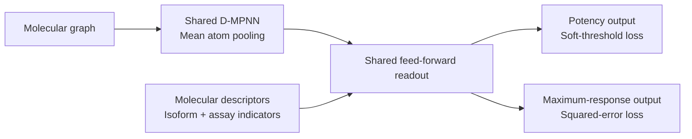

# CYP-Shift: approach to the OpenADMET CYP inhibition challenge

*Methods and results checked against records through 3 November 2026, before
final evaluation. Code is available under the [MIT licence](../LICENSE).*

Dose-response measurements in this challenge are concentrated among screening
hits, leaving many compound–isoform pairs without measured potencies. We combined
these labels with screening and public auxiliary data, compared molecular
representations under scaffold cross-validation, and calibrated an ensemble using
public leaderboard feedback. We also tested a joint dose-response model for
direct and time-dependent inhibition (TDI).

## Challenge data and scoring

The direct-inhibition table contains 4,905 compounds, with 1,412 measured pIC50
values for CYP1A2, 1,285 for CYP2C9, 1,493 for CYP2D6 and 2,335 for CYP3A4. The
single-concentration screen covers 4,376 compounds across all four isoforms
(17,504 measurements); the TDI table contains 6,145 compounds. These sets overlap.

The 750 test compounds are analogues of 75 hits selected on CYP1A2, CYP2C9 and
CYP3A4. CYP2D6 did not guide selection. The primary screen used NADPH
preincubation, so its activity can include TDI and cannot be treated as a point
on the direct-inhibition curve. [Challenge methods](https://openadmet.ghost.io/announcing-openadmets-cyp-inhibition-blind-challenge/)

Regression is ranked by mean soft-threshold relative absolute error (MA-ST-RAE)
across isoforms. For prediction p and supplied 95% credible interval [L, U]:

```text
e(p; L, U) = max(0, L - p) + max(0, p - U)
ST-RAE    = sum(e(prediction; L, U)) / sum(e(mean(y); L, U))
```

Predictions inside the interval incur no error; a constant prediction at the
mean observed pIC50 scores 1. Median training interval widths are 0.22–0.43 pIC50
units across isoforms for compounds with pIC50 ≥ 4, versus 1.21–2.59 below 4.
The score therefore tolerates larger deviations for weak inhibitors while
penalizing predictions outside their bounds. [Official scoring code](https://github.com/OpenADMET/CYP-Challenge-Tutorial/blob/main/evaluation/custom_scoring_functions.py)

## Screening and auxiliary-data selection

The primary screen supplies information where direct potencies are missing.
Within the measured pairs, screen log2 fold-change and direct pIC50 have Spearman
correlations from −0.83 to −0.94. We fitted a decreasing isotonic calibration per
isoform within each training fold, excluding validation compounds' screen
readings. We used pseudo-labels only for missing direct measurements, with weight
0.3 and a separate assay indicator. Readings beyond the weak-activity end of the
calibration became upper bounds: for CYP2D6, this applies to 2,855 of 2,883
additional screen observations.

We retained three auxiliary sources after testing source additions on a fixed
graph model:

| Source | Information used |
|---|---|
| [Octant CYP release](https://huggingface.co/datasets/openadmet/Octant_CYP_inhibition_reactivity_blog_release) | CYP3A4 pIC50 and credible intervals after assay quality filtering |
| [Tox21, Sakamuru et al. (2025)](https://pmc.ncbi.nlm.nih.gov/articles/PMC12155096/) | P450-Glo qHTS potency and maximum inhibition response |
| [Novartis on Polaris](https://polarishub.io/datasets/novartis/novartis-cyp3a4-v1) | Predicted pIC50 for CYP3A4, CYP2C9 and CYP2D6 |

The Novartis values are surrogate labels generated by models trained on in-house
assays. We used 16,372 public compounds with predictions before filtering,
without access to the proprietary measurements: this contribution is knowledge
distillation. [Source paper](https://pubmed.ncbi.nlm.nih.gov/38501689/),
[processing notebook](https://github.com/polaris-hub/polaris-recipes/blob/main/org-Novartis/CYP/00_CYP3A4_data_processing.ipynb)

Adding Novartis improved both MAE and MA-ST-RAE. The comparison below used the
screen plus Octant and Tox21 potency as the baseline, a graph of width 300 and
depth 3, 30 training epochs, and the same five-fold split at seed 0.

| Additional source | Macro MAE | MA-ST-RAE |
|---|---:|---:|
| None | 0.5408 | 0.6553 |
| Novartis | 0.5327 | 0.6415 |
| [ChEMBL](https://www.ebi.ac.uk/chembl/) | 0.5515 | 0.6743 |
| [SAIR](https://huggingface.co/datasets/SandboxAQ/SAIR), potency labels | 0.5485 | 0.6749 |
| [Veith et al. (2009)](https://pubmed.ncbi.nlm.nih.gov/19855396/), qHTS potency | 0.5501 | 0.6640 |

Removing Octant from the three-source model gave 0.6386, a gain of 0.0029 below
our practical adoption threshold of 0.005. We retained all three sources and
removed auxiliary compounds matching direct-training or test compounds by
canonical SMILES.

The shared models also use Tox21 CYP2C19 observations as an auxiliary task.
We selected related enzymes by distance between aligned binding-site residue
descriptors; CYP2C19 received weight 0.589. This task is outside the ninefold
weight budget for the four scored isoforms described below.
[Auxiliary weighting](../src/cypshift/data/auxiliary.py)

Reducing auxiliary data did not give a consistent gain. We compared random,
MaxMin and cluster-based selection within isoform–assay–source groups, using
2,000-row caps or 50–75% retention while holding total auxiliary weight fixed.
Random 75% retention initially improved MA-ST-RAE from 0.6631 to 0.6577; across
three seeds, it averaged 0.6627 versus 0.6621 for all rows. MaxMin and clustering
also failed to improve their controls, so we retained all eligible rows.

## qHTS potency and maximum response

Quantitative high-throughput screening (qHTS) measures concentration–response
curves and supplies both potency and the extent of inhibition. We tested these
quantities separately and together. The selected models use the Tox21 panel;
Veith was an alternative source evaluated above.

| Quantity | Data retained | Use in the selected graph |
|---|---|---|
| Potency (`pic50` mode) | Active compounds with usable AC50; median replicate AC50 converted to −log10(AC50 in mol/L) | Assay-conditioned potency output, trained with soft-threshold absolute error |
| Maximum response (`max_response` mode) | Active and inactive compounds with reported maximum responses | Separate response output, trained with squared error |

For maximum response, we converted negative inhibition percentages to fractions
between 0 and 1 and aggregated replicates by their median. These observations
retain low-response compounds without assigning them an exact potency. We also
tested inactive compounds as censored potency observations. Early Tox21 trials
used an unsupported inactivity bound and do not establish a valid comparison;
the selected Tox21 potency task uses active compounds.
The [loaders](../src/cypshift/data/tox21.py) keep potency and response distinct.

Maximum-response supervision helped when auxiliary weights were balanced across
isoforms. The table shows MA-ST-RAE on the same seed-0 split, with Octant, Tox21
and Novartis throughout. In the balanced setting, each scored isoform's total
auxiliary weight is nine times its retained direct-label count.

| Tox21 supervision | Original source weights | Balanced auxiliary weights |
|---|---:|---:|
| Potency only | 0.6415 | 0.6492 |
| Potency + maximum response | 0.6415 | **0.6369** |

We retained both quantities with balanced weights. LightGBM uses predicted
maximum responses as additional features; TabPFN uses uncensored potency and
assay indicators, without response tasks, screen pseudo-labels or sample weights.

The primary screen remains a separate assay: replacing its isotonic pseudo-labels
with a raw log2 fold-change response task gave 0.6434 versus 0.6369.

## Molecular representations and architecture

We compared LightGBM, multilayer perceptrons, TabPFN,
[Mitra](https://arxiv.org/abs/2510.21204) and directed message-passing neural
networks (D-MPNNs), following early per-isoform forest baselines. Fixed features
included Morgan fingerprints,
physicochemical and substructure descriptors, and frozen CheMeleon or
[MAMMAL](https://arxiv.org/abs/2410.22367) embeddings. We also fine-tuned CheMeleon's
graph encoder. Feature-block comparisons used matching source selections, though
families differed in their handling of censored labels and response tasks.

The selected graph shares its molecular encoder across isoforms and assays.
Directed bond messages produce atom representations, which we average into a
molecular vector. A shared feed-forward readout combines this vector with
molecular descriptors and isoform/assay indicators:



We tested separate encoders per isoform, independent isoform or isoform–assay
heads, and shared hidden layers with separate task outputs. Independent
isoform–assay heads increased MA-ST-RAE from 0.6369 to 0.7168 on the 300-wide graph.
On the regularized 700-wide model, shared hidden layers with task outputs gave
MAE 0.5245 versus 0.5177 for the conditioned readout. We retained the latter;
per-task standardization and a CYP2D6 adaptation layer also remained outside the
selected model.

## Sweeps and validation

Validation had to account for the test set's construction: analogues were
expanded from training hits, while the training library was more diverse. We
therefore considered both generalization across scaffolds and prediction near
known compounds.

| Validation design | Purpose and use |
|---|---|
| Five-fold scaffold CV | Main model comparisons. Compounds sharing a Bemis–Murcko scaffold stay together; stratification balances label coverage. Each compound receives one out-of-fold prediction per seed. |
| Similarity-matched holdouts | Early experiments sampled validation compounds to approximate the test set's nearest-training-neighbour Morgan/Tanimoto similarity distribution. The training library could not fully reproduce the test's analogue density. |
| TDI-specific scaffold folds | Shared folds across classifiers, stratified on the two isoforms' positive-label patterns. We also scored the validation subset within the test's 5th–95th percentile similarity range. |

Scaffold CV gives a consistent comparison but can separate analogues more
strongly than the challenge does. Similarity matching addresses chemical
proximity, not hit-selection bias or missing endpoint labels. Neither recreates
the unknown public/hidden series split. [Split implementation](../src/cypshift/data/splits.py)

Later sweeps changed data sources with the graph fixed, then changed models on
the selected data. Most candidates used one five-fold split; selected graph
configurations were repeated across seeds. The [experiment driver](../scripts/night_run.py)
records the configurations and controls. Comparisons below are paired at seed 0.

| Comparison | Measured result | Selected choice |
|---|---|---|
| Dropout 0.05 / 0.10 / 0.20 on a 500-wide, depth-4 graph | MA-ST-RAE 0.6847 / 0.6682 / 0.6458 | Stronger regularization for larger graphs |
| Width/depth 300/3 → 700/5, with dropout 0.30, peak rate 10⁻⁴ and up to 100 epochs | MAE 0.5304 → 0.5229; MA-ST-RAE 0.6353 → 0.6373 | Regularized 700-wide graph |
| Further increase to width/depth 1,000/6 | MAE 0.5336; MA-ST-RAE 0.6633 | Keep width 700 |
| Per-isoform fine-tuning: 30 epochs at 10⁻⁴ versus 10 at 10⁻⁵ | MA-ST-RAE 0.6553 versus 0.6335 | Shorter, lower-rate fine-tuning |
| Soft-threshold, absolute, squared, quantile and expectile losses; added graph point-error loss | Squared-error LightGBM contributed more to the ensemble than its soft-threshold version | Soft-threshold graph loss; squared-error LightGBM |

We also compared pooled training with direct-assay fine-tuning using a trainable
or frozen encoder. The selected per-isoform fine-tuning retains that isoform's
auxiliary assays. CheMeleon needed a separate schedule: applying the larger
graph's readout and training settings reduced Pearson correlation from about
0.635 to 0.621, so we retained its 30-epoch configuration.

We prioritized MAE, Pearson correlation and R² alongside MA-ST-RAE because lower
local ST-RAE sometimes favored compressed predictions whose calibration did not
transfer to the leaderboard.

Seeds changed both initialization and folds; one baseline had standard deviations
of 0.0035 MAE and 0.0047 Pearson across five runs. TabPFN and LightGBM comparisons
used one seed.

We excluded validation compounds from challenge-derived training observations
and fitted screen calibration within each training fold. Model selection and
some early stopping reused the validation folds; exploratory stacking did not
nest all base-model fits. Scores are therefore development estimates.

Additional sweeps covered the following choices. Early pilots used different
data and splits, so their scores are not directly comparable with the final model.

| Avenue | Scope and finding |
|---|---|
| Cross-CYP transfer | CYP2C19 labels modestly helped an early boosted model (MA-ST-RAE 0.7034 → 0.6972 across three splits); shuffled labels did not. A short leave-one-isoform-out descriptor pilot showed no transfer gain. |
| Screen and assay inputs | Pseudo-labels, predicted screen values, embeddings and response tasks; one-hot, learned and protein-descriptor conditioning, FiLM and assay calibration. We retained pseudo-labels and the conditioned graph. |
| Tabular tuning | LightGBM fingerprint/feature blocks, tree size/count, learning rate and sampling; TabPFN PCA width (32–1,000), mean/median prediction, temperature, ensemble size and sources. Mitra was also evaluated. |
| Training and ensembles | Staged training, encoder freezing, endpoint balancing, normalization, bootstrap bagging, seed averaging and model-family blends. Regularized stacking improved some development scores; learned routing and uncertainty-based point selection did not improve their early controls. |

## Joint prediction of dose-response curves

We tested paired curves to predict direct inhibition and TDI from fitted
potencies and single-concentration responses. For each molecule and isoform,
the model predicts direct and preincubated curves, each with midpoint pIC50,
Hill slope h and maximum inhibited fraction Emax:

```text
inhibition(c) = Emax / (1 + 10^[h × (pC - pIC50)])
pC = -log10(c), with c in mol/L
```

Potency labels constrain midpoints; the primary screen constrains the
preincubated curve at 49.5 µM. TDI follows from the midpoint difference with the
assay-floor rules applied. [Curve implementation](../src/cypshift/models/curve.py)

Six MLP configurations scored MA-ST-RAE 0.807–0.910 and TDI macro Matthews
correlation coefficient (MCC) 0.013–0.057 in five-fold evaluation at seed 0,
behind the selected models. The D-MPNN version received only a short holdout check.

Curve shape remained underdetermined: one concentration cannot identify midpoint,
slope and plateau separately, and these runs did not supervise Emax with released
maximum responses or fit full observed curves. Pooling external assays onto one
direct curve may also matter. A twofold IC50 shift is only 0.301 pIC50 units,
making TDI sensitive to midpoint errors. These are possible explanations for the
result; their contributions were not isolated.

## Selected regression ensemble

[Chemprop v2](https://pubmed.ncbi.nlm.nih.gov/41453060/) was our strongest individual
model family. The selected D-MPNN uses width 700, depth 5, two 700-unit readout
layers, dropout 0.3 and up to 100 epochs at peak learning rate 10⁻⁴, followed by
10 per-isoform epochs at 10⁻⁵. That fine-tuning reduced initial paired-run MAE by
approximately 0.002.

[CheMeleon](https://arxiv.org/abs/2506.15792) was weaker alone but improved ensemble
Pearson correlation for every isoform across three evaluated seeds. Adding 30%
CheMeleon to the five-seed graph average increased CYP2D6 Pearson by about 0.016.
The selected ensemble uses the same weights for all isoforms:

| Component | Weight | Representation and training |
|---|---:|---|
| Chemprop D-MPNN | 0.50 | Graph + descriptors; soft-threshold loss; per-isoform fine-tuning |
| CheMeleon D-MPNN | 0.20 | Pretrained graph, fine-tuned for 30 epochs |
| [TabPFN](https://doi.org/10.1038/s41586-024-08328-6) | 0.15 | Descriptors + CheMeleon embeddings, reduced together to 128 principal components |
| LightGBM | 0.15 | Radius-2, 4,096-bit Morgan fingerprints + descriptors; squared-error loss |

| Out-of-fold predictor, before leaderboard calibration | Macro MAE | Pearson r | R² | MA-ST-RAE |
|---|---:|---:|---:|---:|
| Selected graph, five-seed average | 0.5135 | 0.6599 | 0.4446 | 0.6182 |
| Graph + TabPFN + LightGBM | 0.5082 | 0.6670 | 0.4525 | 0.6064 |
| Four-component ensemble | 0.5064 | 0.6726 | 0.4553 | 0.5980 |

These estimates use five graph seeds, three CheMeleon seeds and seed 0 for each
tabular model. Final fits use five members for each graph and LightGBM component;
TabPFN uses one regressor per isoform with internal ensembling. Nearby weights
gave similar validation scores. The [model specification](../configs/best_regression_model.json)
and [prediction script](../scripts/best_model.py) record the selected settings.

## Calibration from public leaderboard feedback

Adjusting prediction means and spreads improved an early graph model's public
MA-ST-RAE from 0.781 to 0.550. We estimated per-isoform calibration targets from
aggregate R² feedback on affine transformations, then tested shifts and scales
against ST-RAE. These estimates are approximate because public-subset membership
is unknown and the reported metrics are bootstrap summaries.

For the selected ensemble, the following multipliers and shifts are relative to
the initial calibration targets:

| Isoform | Spread multiplier | Mean shift, pIC50 | Public ST-RAE |
|---|---:|---:|---:|
| CYP1A2 | 1.15 | +0.10 | 0.4941 |
| CYP2C9 | 1.00 | 0.00 | 0.3697 |
| CYP2D6 | 1.50 | 0.00 | 0.6514 |
| CYP3A4 | 1.00 | +0.10 | 0.4170 |

The combined public MA-ST-RAE improved from 0.5064 to 0.4831, with macro Spearman
approximately 0.729. These settings were selected using public test feedback;
their benefit on hidden series remains unmeasured. We also checked calibration
and call thresholds using scaffold bootstraps, prevalence sensitivity analyses
and simulated splits of test structures into analogue clusters. These checks
supported retaining the submissions; they do not measure hidden-label accuracy.

## Time-dependent inhibition classification

Direct supervision on binary TDI labels outperformed classification from
predicted potency shifts in the completed comparisons. We added a squared-error
TDI output to the graph and used the separate TDI scaffold folds. Comparisons covered
compounds with direct measurements: 1,495 for CYP2D6 and 2,346 for CYP3A4.

TDI labels without direct measurements were all negative in the examined
training subset. Excluding them increased macro MCC from 0.274 to 0.305 at seed
0, with thresholds matching the evaluated subset's positive fraction; the second
seed scored 0.270. We retained variants assigning these labels weights of 0 and 0.25, with two seeds averaged
for the zero-weight variant.

| Additional TDI experiment | Finding |
|---|---|
| Cross-entropy loss | Better ROC AUC but lower prevalence-threshold macro MCC than squared error (0.242 versus 0.274). |
| Label uncertainty and shift regression | Dropping ambiguous labels, uncertainty weighting and predicting the shift did not improve strong-positive AUC. |
| Auxiliary predictions and Novartis `log_kobs` | Potency/graph outputs were tested as classifier features. The `log_kobs` graph task gave mixed results in two folds and was not retained. |
| Classifier and chemical-feature variants | LightGBM feature/class-weight variants, nearest neighbours, dense-input TabPFN/Mitra and structural alerts were tested. Richer-input TabPFN/Mitra trials remained incomplete. |

Early stacking runs had a missingness shortcut: predicted potency was absent for
compounds without direct measurements, which were all TDI-negative. We excluded
full-table scores affected by this shortcut from model comparisons.

We averaged percentile-transformed scores per isoform. CYP2D6 uses the two graph
variants, LightGBM on CheMeleon embeddings, and a Tanimoto-weighted vote of 15
Morgan-fingerprint neighbours, each weighted 0.25. CYP3A4 uses the two graph
variants and LightGBM on fingerprints and descriptors, each weighted one third.
Out-of-fold ROC AUC was 0.661 and 0.782, respectively. Graph test predictions
average the five fold models. [Classification script](../scripts/tdi_submission.py)

Public metrics imply CYP2D6 prevalence near 7.1%, versus 21.7% in measured
training compounds, motivating threshold adjustment using public feedback.
A tighter CYP2D6 cutoff with a benzodioxole override reduced public MCC; the
final calls follow the ensemble ranking, with 113 CYP2D6-positive and 232
CYP3A4-positive calls among 750 compounds.

## Chemical and structural observations

CYP2D6 differed from CYP3A4 in its association with molecular properties.
Calculated logP correlated with pIC50 at Spearman 0.034 for CYP2D6 and 0.602 for
CYP3A4. Compounds matching a basic aliphatic-amine SMARTS had mean CYP2D6 pIC50
0.554 units higher than non-matches. These unadjusted associations are consistent
with ligand-dependent interactions involving acidic residues Asp301 and Glu216,
but do not identify a specific binding interaction. Additional amine-geometry
descriptors gave only small gains. [Wang et al. (2015)](https://pmc.ncbi.nlm.nih.gov/articles/PMC4335244/)

| Exploratory chemical analysis | Observation and scope |
|---|---|
| Non-CYP auxiliary targets | hERG activity did not correlate positively with CYP2D6 potency on shared ChEMBL compounds (ρ = −0.11, n = 276). |
| Ligand geometry | Single-conformer shape, charge counts and cation-to-aromatic distances were tested but were not selected. |
| Azole-containing compounds | An early boosted model had MAE 0.712 on azoles versus 0.512 elsewhere, motivating a more specific azole descriptor. |

Assay design and selection may also contribute to CYP2D6's distinct behaviour:
it used mass-spectrometric dextromethorphan depletion, while the other isoforms
used fluorogenic probes and guided test-compound selection.
[Assay description](https://openadmet.ghost.io/announcing-openadmets-cyp-inhibition-blind-challenge/)

A single [Boltz-2](https://pubmed.ncbi.nlm.nih.gov/40667369/) CYP1A2–heme–imidazole
check gave a nitrogen–iron distance of 2.19 Å. This geometry check did not
establish predictive accuracy; complex features were not used in the submission.

## Last recorded public results

The last saved leaderboard snapshot, **3 November 2026**, confirmed these scores:

| Track | Submission date (UTC) | Macro score | CYP1A2 | CYP2C9 | CYP2D6 | CYP3A4 |
|---|---|---:|---:|---:|---:|---:|
| Regression, ST-RAE ↓ | 1 November | **0.4831** | 0.4941 | 0.3697 | 0.6514 | 0.4170 |
| TDI classification, MCC ↑ | 2 November | **0.3334** | — | — | 0.2290 | 0.4377 |

These are public-subset results. Final evaluation includes both halves; we have
no final score or measured performance on the hidden series.
[Leaderboard scope](https://openadmet.ghost.io/halfway-through-the-openadmet-cyp-challenge/)
